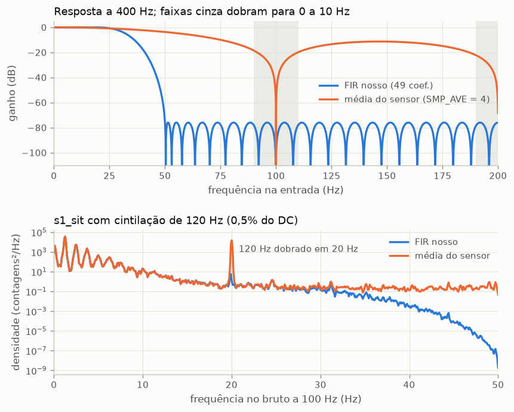

| | |
|---|---|
| Frente | A · João |
| Item do plano | 1 (Piso) |
| Entrada | bruto em taxa alta do sensor (400 Hz na placa, 500 Hz no PhysioNet) |
| Saída | bruto a 100 Hz, com DC |
| Código | `Core/*/pds/decimacao/` |
| Protótipo | `analise/src/analise/decimacao.py` |

**O quê:** anti-aliasing próprio e redução da taxa pra 100 Hz.

## Estado

| Passo | Estado |
|---|---|
| 1. Python, validado no PhysioNet | feito |
| 2. C sem HAL | feito: `decimacao.h`, `decimacao.c`, `decimacao_coef.h` (gerado) |
| 3. Teste no PC contra os vetores | feito: `testes/decimacao/`, no CI |
| 4. Placa com a fonte falsa | código pronto (`-DBANCADA_DECIMACAO=ON`); falta rodar na placa |
| 5. Sensor real | código pronto (linhas `b,` na serial); falta capturar com o dedo |

## Método

### Por que não a média do sensor

O MAX30102 sabe decimar sozinho: com `SMP_AVE = 4` ele tira a média de 4
amostras e entrega 100 Hz. Essa média é um filtro de caixa, com resposta
$|\sin(4\pi f/f_s) / (4 \sin(\pi f/f_s))|$: cai só 3,7 dB em 50 Hz, e o
primeiro lóbulo lateral (~150 Hz) fica em -11 dB. O que está entre 90 e
110 Hz dobra pra 0 a 10 Hz, a faixa do pulso, e a média deixa passar até
-18,5 dB disso. A cintilação de lâmpada na rede de 60 Hz (120 Hz) passa a
-14,8 dB e cai em 20 Hz no bruto. Por isso o sensor roda sem média
(`FIFO_CONFIG = 0x0F`, ver [Firmware](../../firmware/)) e a decimação é nossa.

### Projeto do FIR

FIR de fase linear, equiripple (Parks-McClellan, `scipy.signal.remez`),
normalizado para ganho 1 em DC, porque o bruto mantém o DC.

| Parâmetro | 400 Hz (placa) | 500 Hz (PhysioNet) |
|---|---|---|
| Fator | 4 | 5 |
| Coeficientes | 49 | 61 |
| Banda passante | 0 a 20 Hz, ripple 0,015 dB | 0 a 20 Hz, ripple 0,018 dB |
| Rejeição (≥ 50 Hz) | 75,9 dB | 75,6 dB |
| Pior alias dentro de 0 a 10 Hz | -76,0 dB | -75,6 dB |
| Média do sensor, mesmo critério | -18,5 dB | -18,8 dB |
| Atraso | 24 amostras = 60 ms | 30 amostras = 60 ms |

- **20 Hz de banda passante:** o pulso tem harmônicos até ~10 Hz em
  frequência cardíaca alta, e o entalhe dicrótico depende deles. Com 20 Hz
  sobra margem e o ripple fica abaixo de 0,02 dB.
- **50 Hz de início da rejeição:** é a Nyquist da saída. Tudo acima dobra,
  então tudo acima é atenuado em ~76 dB. Isso fica perto do ruído do ADC
  de 18 bits pro sinal do pulso (0,2 a 2% de um DC de ~100 mil).
- **Tamanho:** escolhido pra que o atraso $(N-1)/2$ seja múltiplo do fator
  nas duas taxas (6 amostras de saída). Assim a saída cai exatamente num
  instante da grade de 100 Hz.



Em cima: as faixas cinza são as que dobram pra 0 a 10 Hz. A média do sensor
deixa passar até -18,5 dB nelas, e o FIR menos de -76 dB. Embaixo: o
trecho de `s1_sit` com cintilação de 120 Hz somada (0,5% do DC). Na média do
sensor ela aparece em 20 Hz com três ordens de grandeza acima do FIR.

### Tempo e o `n`

A saída $n$ é a soma $\sum_j h_j\, x[4n + 24 - j]$ (a 400 Hz), centrada na
entrada $4n$: **a saída $n$ corresponde ao instante $n / 100$ s do sensor**,
sem atraso no rótulo. Ela só fica pronta quando chega a entrada $4n + 24$,
ou seja, a latência é de 60 ms (`DECIMACAO_LATENCIA_SAIDA`). Antes da
primeira entrada, o histórico vale a primeira entrada, e por isso o DC não
tem transiente no começo.

Na placa, amostra perdida pelo sensor (`# perdidas`) entra na decimação como
a última amostra repetida, e o $n$ continua alinhado com o tempo.

### Implementação em C

```c
decimacao_t d;                       /* ~1 KiB, de quem chama */
decimacao_init(&d, MAX30102_FS_HZ);  /* false se a taxa não for 400 nem 500 */
...
decimacao_entrada_t e = {amostra.ir, amostra.vermelho};
ppg_amostra_t bruto;
if (decimacao_processa(&d, &e, &bruto)) {
    /* uma a cada 4 entradas: bruto.n, bruto.ir, bruto.vermelho */
}
```

- Os coeficientes ficam em `decimacao_coef.h`, gerado pelo Python
  (`uv run python -m analise.decimacao --vetores`). O teste
  `test_coeficientes_e_vetor_em_dia` falha se ficar desatualizado.
- **Polifásico:** a soma só é feita quando sai uma amostra (49 produtos por
  canal a cada 4 entradas). Nas demais entradas, só guarda a amostra.
- **Histórico duplicado:** cada amostra é escrita em `i` e `i + N`, então a
  janela é sempre contínua e a soma não tem módulo dentro do laço.
- **Precisão do float:** o histórico guarda o desvio da primeira amostra,
  não o valor cru. O float32 tem 24 bits de mantissa e o DC é de ~100 mil;
  com o desvio, a soma só carrega o pulso e a deriva. Na saída, a primeira
  amostra volta somada. DC constante sai **exatamente** igual.

## Validação

### 1. Python no PhysioNet

`uv run python -m analise.decimacao` decima os 22 registros `sit`
(60 s a partir de 30 s) por quatro caminhos. Mediana dos 22:

| Caminho | RMS contra o scipy (contagens) | RMS (% do pulso) | IBI do PPG − RR do ECG, RMS (ms) | Pares de batimentos |
|---|---|---|---|---|
| original a 500 Hz | — | — | 6,6 | 1614 |
| **FIR 500 → 100 Hz** | 1,69 | 0,14% | **6,5** | 1614 |
| **FIR 400 → 100 Hz** (como na placa) | 1,69 | 0,14% | **6,9** | 1581 |
| média do sensor 400 → 100 Hz | 1,89 | 0,17% | 8,0 | 1592 |

- **Contra o ECG**, que é o gabarito: o intervalo entre picos do PPG
  (interpolação parabólica) é comparado batimento a batimento com o RR do
  ECG. Depois do FIR, o erro é o mesmo do sinal original a 500 Hz (6,5 a
  6,9 ms contra 6,6 ms). A decimação não piora o tempo dos batimentos. A
  média do sensor piora pra 8,0 ms. O que sobra nos 6,6 ms é a variação do
  tempo de trânsito do pulso, não a decimação.
- **Contra o scipy** (`resample_poly`, fase zero, a referência da fonte
  falsa): diferença de 0,14% da amplitude do pulso. É o que existe entre 20
  e 50 Hz, que o nosso FIR corta e o do scipy deixa.

### 2. C no PC

`testes/decimacao/teste_decimacao.c`, no CI (`pds-host`):

| Caso | Entrada | Saídas | Maior erro contra o Python |
|---|---|---|---|
| `sensor_400hz` | fonte falsa, 10 s a 400 Hz | 994 | 0,0078 contagens (1 ulp do float32) |
| `physionet_500hz` | `s1_sit` cru, 10 s a 500 Hz | 994 | 0,0078 contagens |

A tolerância é de 0,05 contagens. O teste também confere que taxa sem filtro
é recusada, que DC sai exato, que um degrau só mexe nas saídas a menos de
60 ms dele (a janela do FIR) e que o `init` reinicia o `n`. Deslocar a saída em uma única amostra de
entrada faz 966 das 994 saídas falharem.

### 3. Placa com a fonte falsa

```bash
cmake --preset Debug -DBANCADA_DECIMACAO=ON
cmake --build --preset Debug
STM32_Programmer_CLI -c port=SWD -w build/Debug/sensor-ppg.elf -v -rst
```

Na partida, a placa toca os 4000 pontos da fonte falsa a 400 Hz na decimação
e confere com o mesmo vetor do teste no PC. O resultado sai pela serial:

```text
# bancada decimacao: 994 saidas (esperado 994), 0 fora da tolerancia, erro max 8 milesimos
# bancada decimacao: ciclos por amostra med ... max ... (orcamento 2400): OK
```

**Orçamento:** 1% da CPU por amostra do sensor, ou seja, 96 MHz / 400 Hz /
100 = 2400 ciclos em média. Pela contagem de instruções do laço em `-O0`
(Debug), a estimativa é de ~1000 ciclos em média e ~3500 na amostra que
solta a saída. A média é o que pesa na CPU. O FPU do Cortex-M4 pode fundir
multiplicação e soma (FMA), então o erro na placa pode passar um pouco do
1 ulp do PC, ainda bem abaixo dos 50 milésimos.

**Resultado na placa:** *(preencher com a saída da bancada)*

### 4. Sensor real

Com o firmware normal, a placa manda o sinal cru a 400 Hz e, junto, o bruto
que ela mesma decimou (linhas `b,n,ir,vermelho`). A captura grava os dois, e
o Python confere a decimação da placa contra a dele no mesmo sinal real:

```bash
uv run python -m analise.captura COM3 --segundos 60
uv run python -m analise.decimacao --confere dados/sensor_<data>_<hora>.csv
```

Sem ECG na placa, a referência disponível é o protótipo: o erro tem que ficar
nos centésimos (a serial manda 2 casas), e o pulso tem que aparecer no bruto
de 100 Hz com a mesma forma do cru. A cada 10 s, a serial também manda
`# decimacao: ciclos med ... max ...` com o sensor de verdade.

**Resultado com o sensor:** *(preencher com a saída do `--confere` e os ciclos)*
