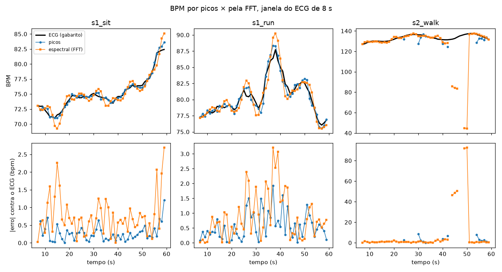

| | |
|---|---|
| Frente | C · Celso |
| Item do plano | 3b (Piso) |
| Entrada | filtrado |
| Saída | bpm_espectral |
| Código | `Core/*/pds/espectral/` |

**O quê:** BPM pela FFT em janela deslizante.

## Estado

| Passo | Situação |
|---|---|
| 1. Python (`analise/src/analise/espectral.py`) | feito, validado em 15 registros do PhysioNet |
| 2. C (`Core/*/pds/espectral/`) | feito, bate com o Python (erro máx. de 7,6e-5 bpm) |
| 3. Teste no PC (`testes/espectral/`) | feito, 3 casos contra os vetores do Python |
| 4. Placa com a fonte falsa | feito: `-DBANCADA_ESPECTRAL=ON`, 53 de 53 saídas iguais ao Python, ciclos medidos (DWT) |
| 5. Sensor real | feito: dedo no MAX30102, placa × Python iguais, ~1 bpm do picos |

Esta página é atualizada em todo PR que mexe no módulo.

## Método

Recebe o **filtrado** (0,5 a 4 Hz, média zero, a 100 Hz) uma amostra por vez,
guarda as últimas `JANELA_S` e, a cada `HOP_S`, com a janela cheia, devolve um
`ppg_bpm_t`:

1. **Tira a média** da janela.
2. **Janela de Hann.** Sem ela, o corte abrupto das bordas espalha o pico por
   todo o espectro (vazamento espectral).
3. **Zero-padding até `NFFT`.** Não traz informação nova, mas interpola o
   espectro e deixa o pico mais fácil de localizar.
4. **Maior pico de potência na banda de 0,7 a 3,5 Hz** (bins 8 a 35, de 0,78 a
   3,42 Hz). Com a regra do máximo local (passo 6), a faixa que sai válida vai, na
   prática, de **~44 a ~208 bpm** (medido com senoides).
5. **Interpolação parabólica** em volta do pico, no log da amplitude. É o que
   faz o erro cair para cerca de 1 bpm, mesmo com a resolução de 7,5 bpm.
6. **Validade:** o pico precisa ser máximo local (maior ou igual aos dois vizinhos) e,
   junto com os vizinhos, ter 30% ou mais da potência da banda (a *prominência*, de
   0 a 1). Ruído branco quase nunca passa; um pulso com ruído passa. Na borda da
   banda, o vizinho de fora entra na soma: sem a regra do máximo local, um componente
   abaixo de 0,7 Hz ou acima de 3,5 Hz (o filtro deixa passar de 0,5 a 4 Hz) vazava
   pro bin da borda e a parábola devolvia um BPM fora da banda como válido.

**Resolução × atraso.** A resolução da FFT é `1 / JANELA_S` (8 s dá 0,125 Hz, ou 7,5
bpm entre bins), e o BPM é o da janela inteira, então chega com atraso de cerca de
`JANELA_S / 2`. Janela longa resolve melhor e responde mais devagar.

**Parâmetros:** `JANELA_S = 8 s`, `HOP_S = 1 s`, `NFFT = 1024`, 800 amostras de
janela. A janela de 8 s é o meio-termo medido abaixo.

## Em C

`espectral_t` guarda a janela de 800 amostras, a janela de Hann (calculada no
`espectral_init`), as duas áreas da FFT de 1024 pontos e o estado: **~14,7 KB de RAM**
(aloque fora da pilha). `espectral_processa()` devolve `true` uma vez por segundo, a
partir da amostra 800, e **`bpm = 0` quando `valido = false`**, como o `picos_bpm()`
(o display mostra "--"). A FFT é a do módulo [FFT](../fft/) (CMSIS-DSP).
O `espectral_init()` devolve `bool` (o molde do `ppg.h` é `void`): `false` quando a FFT
de 1024 pontos não foi compilada, como o `decimacao_init()` faz com uma taxa sem filtro.

Diferenças pro Python, todas dentro da tolerância: o C faz as contas em `float` (a janela de
Hann com `cosf`, a média por soma sequencial) e o NumPy em `float64`/pairwise. No teste
(`testes/espectral/teste_espectral.c`, sobre 60 s do `s1_sit`, do `s2_walk` e de um caso
sintético `borda`, com silêncio e senoides perto das bordas da banda, 53 saídas cada) o
`valido` sai **igual em todas** e o BPM difere no máximo **7,6e-5** (tolerância
1e-3); reiniciar dá o mesmo resultado. O teste falha de verdade: com o limite de
validade em 0,6 em vez de 0,3, o `s2_walk` dá 35 diferenças; sem a regra do máximo
local, o `borda` dá diferenças no `valido`.

**O `n` da saída** é o da amostra filtrada em que a janela terminou, e o filtrado chega
`PPG_ATRASO_AMOSTRAS` (1 s) depois do sinal. Pra comparar com outra referência de tempo
(o ECG, por exemplo), desconte esse atraso.

**Custo estimado** (código ARM emulado, modelo do Cortex-M4F, `arm-none-eabi-gcc` 16.2.0; ver
[FFT](../fft/); o medido na placa está abaixo): **~1 060 ciclos por amostra em média** nos 60 s
do vetor, contando os 8 s em que a janela enche (~1 180 em regime) (orçamento 9 600) e **~107 400 no
pior caso**, a amostra em que sai a FFT (orçamento 960 000, 11% de um período de amostra,
1,1 ms a 96 MHz). Em Release,
o espectral acrescenta ~26 KB de flash e ~14,7 KB de RAM ao firmware.

**Na placa com a fonte falsa (passo 4,** `-DBANCADA_ESPECTRAL=ON`, Release, 22/11/2026):

```text
# bancada espectral: 53 saidas (esperado 53), 0 fora da tolerancia, erro max 0 milesimos
# bancada espectral: ciclos por amostra med 951 (orcamento 9600), max 101323 (orcamento 960000): OK
```

O pior caso **medido** pelo contador de ciclos (DWT) é de ~101 300 ciclos, ou 1,06 ms dos
10 ms de um período de amostra (a emulação estimava ~107 400). Com o firmware normal,
em regime (janela cheia, uma FFT por segundo), o `# espectral:` mostra média de
~1 070 ciclos por amostra e máximo de ~101 300. Roda junto com a bancada da respiração
sem mudar nada.

**Com o sensor real (passo 5,** dedo do André parado, 60 s, 22/11/2026): o
`main.c` de então (hoje a cadeia, `pds/cadeia/`, chamada pelo `app.c`) passava o
filtrado pelo espectral e mandava `e,n,bpm_valido,bpm` a cada segundo.
O Python rodou no mesmo filtrado que a placa mandou (linhas `f,`), janela a janela:

| O quê | Resultado |
|---|---|
| Saídas comparadas | 30 de 60 (3 linhas perdidas na serial tiraram as outras janelas) |
| `valido` placa × Python | igual em todas |
| BPM placa × Python | diferença máxima de 0,005 (o filtrado vem com 2 casas) |
| BPM da placa | 60 de 60 saídas válidas, de 55,6 a 73,9 bpm (mediana de 64,4 nas 30 comparadas) |
| Espectral × picos, janela a janela | \|diferença\| mediana de 1,06 bpm, máxima de 9,5 |

Pro picos, o BPM de referência é 60 / RR médio dos batimentos com `rr_valido` cujo
`n_pico` cai na mesma janela. Como o `n_pico` já desconta `PPG_ATRASO_AMOSTRAS` e o `n`
do espectral não, a janela vai de `n - 900` a `n - 100`; sem esse recuo, a diferença
mediana sobe pra 1,4 bpm. O script dessa comparação (`--confere`) vem num PR à parte.

**Sem dedo, sai válido.** Antes do dedo, só com ruído no sensor, a placa marcou de 135 a
141 bpm como válido. O espectral não sabe se há dedo: isso é do módulo `qualidade`.

## Validação

Contra o ECG do PhysioNet (Pulse Transit Time PPG): 5 pessoas × (sentado,
andando, correndo), 60 s de cada registro a partir de 30 s, sobre o `filtrado_ir`
da fonte falsa. Reproduzir: `uv run python -m analise.espectral_validacao`.

- **Erro:** |BPM da FFT − BPM do ECG na mesma janela|, em que o BPM do ECG é `60 /
  média dos RR` dentro da janela.
- **Atraso:** quantos segundos antes do fim da janela o BPM da FFT mais combina
  com a frequência cardíaca instantânea do ECG (RR suavizado em 5 batimentos).

O fim de cada janela, no tempo do ECG, é `n - PPG_ATRASO_AMOSTRAS` (ver acima).

**Estudo da janela** (mediana dos 15 registros; p95 é a média dos 15):

| Janela | NFFT | Resolução | Válidos | Erro mediano | Erro p95 | Atraso |
|---|---|---|---|---|---|---|
| 4 s | 1024 | 15 bpm | 97,8% | 0,84 bpm | 9,8 bpm | 2,5 s |
| 6 s | 1024 | 10 bpm | 99,5% | 0,79 bpm | 6,0 bpm | 3 s |
| **8 s** | 1024 | 7,5 bpm | 99,6% | **0,84 bpm** | 6,7 bpm | **4 s** |
| 10 s | 1024 | 6 bpm | 99,6% | 1,02 bpm | 7,3 bpm | 5 s |
| 12 s | 2048 | 5 bpm | 98,9% | 0,93 bpm | 4,0 bpm | 6 s |
| 16 s | 2048 | 3,8 bpm | 98,8% | 1,08 bpm | 4,0 bpm | 8 s |

O atraso medido é cerca de metade da janela, como previsto. O erro **mediano** quase não
muda com a janela: a interpolação parabólica já recupera a precisão. O que a
janela longa melhora são os erros grandes (p95), ao custo de atraso. A de 8 s
dá erro mediano de 0,84 bpm com atraso de 4 s.

**Com a janela de 8 s** (`--tabela`), o erro mediano fica entre 0,59 e 1,23 bpm em 14 dos
15 registros (sentado, andando e correndo), com 100% das saídas válidas em 14 deles.

**Limitação conhecida:** em `s2_walk` e `s2_run` o artefato de movimento é maior
que o pulso. `s2_walk` tem erro p95 de 50 bpm (94% válidas) e `s2_run`, mediana de 2,9
bpm e p95 de 15,2. O limite de 30% quase não rejeita esses trechos: o pico do
artefato também é forte, então sai **válido e errado**. É o mesmo caso que atrapalha o módulo `picos`, e a resposta é a
mesma: o módulo `qualidade` marca o trecho como inutilizável.

**Outra limitação:** a prominência é relativa à banda, não ao espectro todo. Uma senoide
forte fora da banda e longe da borda (3,8 Hz, por exemplo) deixa na banda só o lóbulo
lateral da janela de Hann, que é pico local e concentra a potência da banda: sai válido,
com ~195 bpm. Em PPG de verdade o pulso domina a banda e isso não aparece; o caso fica
registrado no vetor `borda`.

### FFT × picos, contra o ECG

Os dois módulos recebem o mesmo `filtrado_ir` (os mesmos 15 registros, 60 s a partir
de 30 s) e são lidos nos mesmos instantes: os da FFT, um por segundo, no fim de cada
janela de 8 s (com o `PPG_ATRASO_AMOSTRAS` descontado). O `bpm_picos` é o último que o
módulo [picos](../picos/) tinha emitido até ali (média dos 8 últimos RR válidos, segurada
entre batimentos); o do ECG é `60 / média dos RR` na mesma janela de 8 s. Reproduzir, de
`analise/`: `uv run python -m analise.comparacao_bpm` (tabela por registro) e `--figura`
(a figura abaixo).



Mediana dos registros de cada atividade (5 por atividade), **picos / FFT**:

| Atividade | Erro mediano (bpm) | Erro p95 (bpm) | Atraso (s) | Estabilidade (bpm) | Válidos (%) |
|---|---|---|---|---|---|
| Sentado | 0,30 / 0,73 | 1,08 / 2,59 | 3,5 / 4,0 | 0,57 / 0,84 | 100 / 100 |
| Andando | 0,86 / 1,02 | 2,20 / 3,22 | 3,5 / 4,0 | 0,84 / 0,81 | 94 / 100 |
| Correndo | 0,72 / 0,82 | 2,60 / 2,69 | 4,0 / 4,0 | 0,75 / 0,77 | 100 / 100 |
| **Todos (15)** | **0,71 / 0,84** | **2,13 / 2,91** | **3,5 / 4,0** | **0,70 / 0,81** | **100 / 100** |

- **Erro:** \|BPM − BPM do ECG na janela\|. Sentado, a FFT erra mais que o dobro do picos
  (0,73 contra 0,30 bpm): ela é uma estimativa por interpolação sobre bins de 7,5 bpm, e o
  picos mede intervalos de verdade. Em movimento os dois ficam em ~1 bpm.
- **Atraso:** o da FFT é metade da janela (4 s, como previsto); o do picos é parecido
  (~3,5 s), porque ele é a média dos 8 últimos RR. **Não é o atraso que separa os dois.**
- **Estabilidade:** mediana de \|BPM[k] − BPM[k−1]\| entre saídas de 1 s. O próprio ECG,
  na mesma janela, varia 0,53 bpm de um segundo para o outro; a FFT fica em 0,81 e o
  picos em 0,70.
- **Válidos:** a FFT dá BPM sempre que o pico concentra 30% da potência da banda (94% ou
  mais dos instantes, em qualquer atividade); o picos só com ritmo regular, e fica sem
  BPM em parte do tempo em movimento (`s2_walk` 23%, `s3_run` 75%, `s3_walk` 79%).

**O que a média esconde:** em `s2_walk` a FFT dá BPM válido o tempo quase todo e erra
feio quando o artefato de movimento passa o pulso (45 a 85 bpm contra ~135 do ECG, p95
de 49,7 bpm). O picos, nessa hora, recusa o ritmo e fica sem número; o que sobra tem p95
de 8,3 bpm. **Ficar sem resposta é melhor que dar a errada**: a prominência da FFT não
separa pulso de artefato, e a regularidade dos RR do picos separa.

**Conclusão:** a FFT fica como segunda opinião independente do `bpm_picos`, que é o BPM
do produto: não depende de achar cada batimento, mas é menos exata e não sabe dizer
quando erra.
