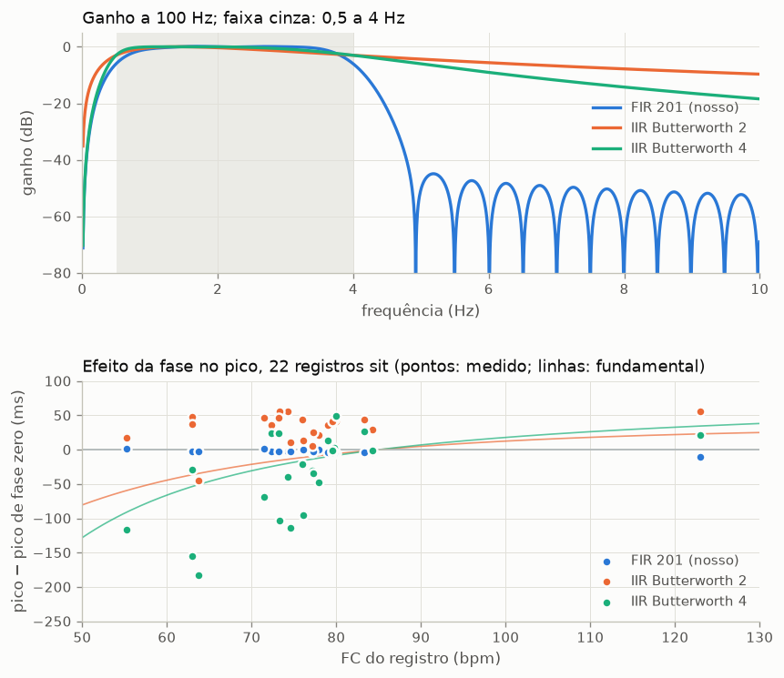
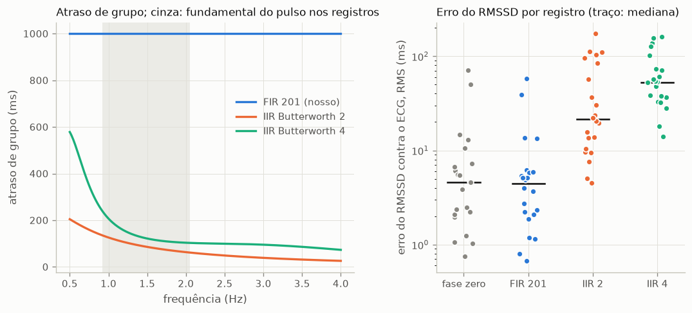

| | |
|---|---|
| Frente | A · João |
| Item do plano | 2 (Piso) |
| Entrada | bruto (100 Hz, com DC) |
| Saída | filtrado (100 Hz, média zero, atrasado de `PPG_ATRASO_AMOSTRAS` = 100) |
| Código | `Core/*/pds/filtro/` |
| Protótipo | `analise/src/analise/filtro.py` |

**O quê:** remoção de DC e passa-faixa 0,5 a 4 Hz.

## Estado

| Passo | Estado |
|---|---|
| 1. Python, validado no PhysioNet | feito, com a comparação IIR × FIR |
| 2. C sem HAL | feito: `filtro.h`, `filtro.c`, `filtro_coef.h` (gerado) |
| 3. Teste no PC contra os vetores | feito: `testes/filtro/`, no CI |
| 4. Placa com a fonte falsa | código pronto (`-DBANCADA_FILTRO=ON`); falta rodar na placa |
| 5. Sensor real | código pronto (linhas `f,` na serial); falta capturar com o dedo |
| Efeito da fase no pico, no RR e no HRV (#32) | feito: `analise/src/analise/fase_pico.py`, seção abaixo |

## Método

### IIR × FIR: o efeito da fase no pico

A saída do filtro alimenta o `picos`, e o HRV depende do **instante** de cada
pico: o RMSSD típico é de 20 a 50 ms. O `ppg.h` corrige o atraso do filtro com
uma constante só, `PPG_ATRASO_AMOSTRAS`. Isso só funciona se o atraso for o
mesmo em todas as frequências, ou seja, com fase linear.

Foram comparados nos 22 registros `sit` do PhysioNet, com FC de 55 a 123 bpm
e 120 s cada, depois da nossa decimação:

- **FIR nosso**: fase linear, atraso de 100 amostras em todas as frequências.
- **IIR Butterworth** de ordem 2 e 4, causal: é o que caberia em poucas
  linhas e poucos ciclos.

A referência é o mesmo passa-faixa de fase zero (`filtfilt`) da fonte falsa:
o pico "certo", sem atraso nenhum.

| Filtro | Pico − pico de fase zero (ms), mediana (mín..máx entre registros) | Variação dentro do registro (ms) | IBI do PPG − RR do ECG, RMS (ms) |
|---|---|---|---|
| **FIR 201 (nosso)**, menos 100 amostras | **−2,9 (−10,3..1,4)** | **2,8** | **7,8** |
| IIR Butterworth 2 | 39,5 (−44,5..56,3) | 15,7 | 13,1 |
| IIR Butterworth 4 | −29,8 (−182,8..49,8) | 51,8 | 39,0 |



- No IIR, o pico **muda de lugar conforme a FC**. Abaixo do centro da
  banda ($\sqrt{0{,}5 \cdot 4} \approx 1{,}4$ Hz, ou 85 bpm), a fase do
  passa-faixa está adiantada e o pico tende a sair antes. Acima, tende a sair
  depois. A linha do gráfico é a previsão pela fundamental,
  $-\varphi(f)/(2\pi f)$: ela explica a tendência, mas não o valor, e nem
  sempre o sentido. Os harmônicos do pulso são atrasados de forma diferente, e
  a onda se deforma (o pico vira outro ponto da onda). Num pulso sintético
  estreito, o IIR de ordem 4 atrasa o pico em ~50 ms em vez de adiantar, e
  nos 22 registros `sit` de 300 s (seção abaixo) o de ordem 2 atrasa o pico na
  maioria deles, mesmo abaixo de 85 bpm: a tendência pela fundamental só
  aparece clara no de ordem 4.
  Não existe um `PPG_ATRASO_AMOSTRAS` que sirva pra todo mundo, e de
  −183 a +56 ms é bem mais que o RMSSD inteiro.
- Dentro do mesmo registro, a FC varia de batimento a batimento, então o pico
  do IIR também oscila (16 a 52 ms). Isso vai direto pro IBI e pro HRV.
- No FIR, o pico fica a poucos ms da referência em qualquer FC. O que sobra
  vem da diferença de ganho entre os dois, não da fase.

**Decisão: FIR de fase linear.** O custo é a latência de 1 s, que só atrasa
o display, e mais memória e ciclos que um IIR. As duas coisas cabem
(abaixo).

### Com o detector e o HRV de verdade (#32)

A tabela acima usa um detector simples. Com o `picos` (#23) e o `hrv` prontos,
a comparação foi refeita com o caminho de verdade da cadeia:
`uv run python -m analise.fase_pico`. Para cada um dos 22 registros `sit`
(300 s, FC de 54 a 123 bpm), o bruto decimado passa por cada filtro, e o
filtrado vai pro `picos.detecta()`, igual na cadeia. Os instantes vão pro
`hrv.Hrv` (SDNN e RMSSD em janelas de 60 s), que é comparado batimento a
batimento com o HRV dos picos R do ECG (mesmo método do `hrv.valida_registro`).
O fase zero entra como controle: o que ele erra é do sinal e da detecção, não
da fase.

| Filtro | Pico − pico de fase zero (ms), mediana (mín..máx) | Variação no registro (ms) | RR − RR do ECG, RMS (ms) | Erro do SDNN (ms) | Erro do RMSSD (ms) |
|---|---|---|---|---|---|
| fase zero (controle) | 0 | 0 | 8,1 | 1,9 | 4,6 |
| **FIR 201 (nosso)** | **−2,6 (−9,2..1,4)** | **3,3** | **7,4** | **2,0** | **4,5** |
| IIR Butterworth 2 | 37,3 (−40,2..55,9) | 25,5 | 28,7 | 6,5 | 21,3 |
| IIR Butterworth 4 | −25,0 (−156,7..52,2) | 58,9 | 61,1 | 18,8 | 52,8 |

Erros RMS, mediana dos 22 registros. O HRV de referência (ECG) tem mediana de
SDNN 49 ms e RMSSD 33 ms.



- **O FIR não acrescenta erro mensurável no RR nem no HRV.** O RR e o HRV saem iguais aos do filtro
  de fase zero, que não existe em tempo real. Os dois registros em que o FIR
  erra o RMSSD em 40 a 60 ms (s8 e s17) também erram com o fase zero (51 a
  71 ms): ali o problema é o sinal, não o filtro.
- **Com o IIR, o HRV deixa de servir.** O IIR de ordem 2 erra o RMSSD em 21
  ms, 65% do RMSSD típico (33 ms). O de ordem 4 erra em 53 ms, mais que o
  próprio RMSSD. O SDNN sofre menos, porque é dominado pela variação lenta,
  mas também triplica.
- **Por quê:** à esquerda, o atraso de grupo. O do FIR é 1000 ms em todas as
  frequências, uma reta. O do IIR de ordem 4 vai de ~580 ms em 0,5 Hz a ~100 ms
  em 2 Hz, justamente na faixa da fundamental do pulso (a faixa cinza). Cada
  componente da onda atrasa diferente, a onda se deforma, e o pico se desloca
  conforme a FC e a forma do pulso de cada pessoa. A FC varia batimento a
  batimento, então o pico do IIR também oscila dentro do mesmo registro
  (desvio padrão mediano de 25 ms na ordem 2 e de 59 ms na ordem 4), e isso
  entra direto no RR.

### Por que `PPG_ATRASO_AMOSTRAS = 100`

1. **É o atraso exato do FIR.** Um FIR simétrico de $N$ coeficientes atrasa
   todas as frequências em $(N-1)/2$ amostras: com 201, são 100 amostras = 1 s.
   O atraso de grupo calculado é 100,000 amostras de 0,5 a 4 Hz (teste
   `test_atraso_de_grupo`), e o `filtro.c` confere isso na compilação.
2. **Medido, sobra menos de uma amostra.** Usando exatamente 100, o pico do
   FIR fica, na média de cada registro, a 3,6 ms RMS do de fase zero (pior
   registro: 9,2 ms). A constante que melhor alinharia seria 100 − 0,26
   amostra (−2,6 ms, a mediana dos registros), e mesmo ela deixa 2,4 ms RMS
   (pior: 6,6 ms): o que sobra vem da diferença de ganho entre o FIR e o
   Butterworth da referência, não da fase. Como a constante é um número
   inteiro de amostras, trocar pra 99 ou 101 erraria 10 ms em todo pico.
3. **Pro IIR não existe valor certo.** O melhor atraso constante pro IIR de
   ordem 2 seria +3,7 amostras, e mesmo assim sobram 21,7 ms RMS entre
   registros (pior: 77,5 ms). Pro de ordem 4, −2,5 amostras e 57,7 ms RMS
   (pior: 131,7 ms). Isso é só a parte entre registros (a média de cada um);
   dentro de cada registro o pico ainda varia de batimento a batimento (coluna
   "Variação no registro" da tabela). Qualquer constante deixa um erro maior
   que o RMSSD que se quer medir.
4. **Pro HRV, só os intervalos importam**, e um atraso constante se cancela no
   RR. A constante serve pro instante absoluto do pico (comparar com o ECG da
   fonte falsa, tempo de trânsito do pulso), e por isso ela tem que ser a mesma
   em todo batimento. É o que só a fase linear garante.

### Projeto do FIR

`scipy.signal.firwin`, janela de Hamming, 201 coeficientes, bordas de −6 dB
em 0,5 e 4 Hz (as mesmas da referência). Depois, a média dos coeficientes é
subtraída: **ganho em DC exatamente 0**, e é isso que remove o DC.

| Frequência | 0 | 0,05 Hz | 0,2 Hz | 0,5 Hz | 1 Hz | 2 Hz | 4 Hz | 6 Hz |
|---|---|---|---|---|---|---|---|---|
| Ganho (dB) | −∞ | −43 | −20 | −6 | −0,7 | 0,0 | −6 | −73 |

- **Por que janela, e não equiripple (Remez):** testado com 151 a 401
  coeficientes, o Remez deixa ~2 dB de ondulação na banda passante. Isso deforma
  o pulso, e o erro do IBI subiu pra 9,5 a 11,8 ms. A janela de Hamming tem a
  banda passante lisa.
- **Por que 201:** é o tamanho em que a deriva (0,05 a 0,2 Hz, respiração e
  movimento lento) cai de 20 a 43 dB. Com 101, a borda de baixo nem existe,
  porque a transição da janela é de ~3 Hz. Mais longo deixa mais latência e não
  melhora o pico.
- **Atraso:** $(201 - 1)/2 = 100$ amostras = 1 s, inteiro.
  `PPG_ATRASO_AMOSTRAS` passou de `0.0f` pra `100.0f`, e o `filtro.c`
  confere isso na compilação (`_Static_assert`).

### Implementação em C

```c
filtro_t f;                    /* ~3,2 KiB, de quem chama */
filtro_init(&f);
...
ppg_amostra_t filtrado;
filtro_processa(&f, &bruto, &filtrado);   /* sempre true; filtrado.n == bruto.n */
```

- Os coeficientes ficam em `filtro_coef.h`, gerado pelo Python
  (`uv run python -m analise.filtro --vetores`). O teste
  `test_coeficientes_e_vetor_em_dia` falha se ficar desatualizado.
- **Simetria:** $h_j = h_{N-1-j}$, então a soma vira
  $h_{100} x_{100} + \sum_{j<100} h_j (x_j + x_{N-1-j})$. São 101
  multiplicações por canal, e não 201.
- **Histórico duplicado:** a janela é sempre contínua, igual na decimação.
- **Começo sem transiente:** o histórico guarda o desvio da primeira amostra,
  e a parte antes da primeira amostra vale 0, ou seja, a própria primeira
  amostra. Como o ganho em DC é 0, o filtrado começa em 0, e não com um pico
  de ~100 mil. Ele vale depois de 201 amostras (2 s).

### A fonte falsa

O `filtrado_100hz` da fonte falsa agora é este FIR (antes era o `filtfilt`,
com atraso 0), atrasado de `PPG_ATRASO_AMOSTRAS` como na placa. Quem testa o
`picos` com a fonte falsa subtrai o atraso igual na cadeia de verdade. Os
picos do filtrado, menos 100 amostras, caem 0,13 s depois do R do ECG (p10 a
p90: 0,124 a 0,138 s), que é o tempo de trânsito do pulso até o dedo.

## Validação

### 1. Python no PhysioNet

`uv run python -m analise.filtro`, tabela acima. Contra o ECG, o IBI do PPG
filtrado erra 7,8 ms RMS (mediana dos 22 registros, 3130 pares de
batimentos). Isso fica na faixa do sinal antes do filtro (6,5 a 6,9 ms, ver
[Decimação](../decimacao/)), e o resto é a variação do tempo de trânsito do
pulso. Os IIR erram 13 e 39 ms.

### 2. C no PC

`testes/filtro/teste_filtro.c`, no CI (`pds-host`):

| Caso | Resultado |
|---|---|
| bruto da fonte falsa, 60 s (6000 amostras), contra o Python | maior erro 0,00008 contagens (tolerância 0,05) |
| `n` da saída igual ao da entrada | 6000 de 6000 |
| DC constante até 262143 | sai exatamente 0 |
| senoide de 1,5 Hz | ganho 1,006, atrasada de exatamente 100 amostras |
| 0,05 Hz e 6 Hz | ganho 0,007 e 0,0002 |
| `init` de novo | reinicia o histórico |

Trocar um índice da dobra da simetria faz 5918 das 6000 saídas falharem.

### 3. Placa com a fonte falsa

```bash
cmake --preset Debug -DBANCADA_FILTRO=ON
cmake --build --preset Debug
```

Na partida, a placa passa os 60 s do bruto da fonte falsa pelo filtro e
confere com o mesmo vetor do teste no PC:

```text
# bancada filtro: 6000 saidas, 0 fora da tolerancia, erro max 0 milesimos
# bancada filtro: ciclos por amostra med ... max ... (orcamento 19200): OK
```

**Orçamento:** 2% da CPU por amostra a 100 Hz, ou seja, 96 MHz / 100 Hz ×
2% = 19 200 ciclos. Pela contagem de instruções do laço em `-O0` (Debug),
~27 instruções por par de coeficientes. A estimativa é de ~7 500 ciclos por
amostra (101 iterações × 2 canais).

**Resultado na placa** (STM32F411, Debug `-O0`, 21/11/2026):

```text
# bancada filtro: 6000 saidas, 0 fora da tolerancia, erro max 0 milesimos
# bancada filtro: ciclos por amostra med 9844 max 9944 (orcamento 19200): OK
```

As 6000 saídas batem com o Python (erro abaixo de 0,0005 contagens). O custo
real ficou em 9 844 ciclos por amostra, 31% acima da estimativa de 7 500 e
51% do orçamento. A bancada segura o laço por ~0,6 s, e logo depois sai um
`# perdidas: 31` (o contador do MAX30102 satura em 31; perdeu-se mais que
isso, mas só nesse intervalo da partida).

### 4. Sensor real

O firmware passa cada bruto pelo filtro e, com `-DSERIAL_COMPLETA=ON`, manda as
duas linhas (`b,...` e `f,...`); o padrão manda só a `b,`. A captura grava `_bruto.csv` e `_filtrado.csv`, e o Python refaz o
filtro sobre o bruto da placa:

```bash
uv run python -m analise.captura COM3 --segundos 60
uv run python -m analise.filtro --confere dados/sensor_<data>_<hora>.csv
```

Sem ECG na placa, a referência disponível é o mesmo bruto filtrado com fase
zero. O `--confere` mostra o erro contra o Python (centésimos), quantos picos
casaram, o deslocamento deles contra a fase zero (tem que ficar em poucos ms,
como no PhysioNet) e o BPM. Com a placa simulada no PC (mesmo `filtro.c`,
fonte falsa a 400 Hz), deu 794 saídas, erro de 0,008 contagens e picos a
−1,4 ms da fase zero.

**Resultado com o sensor** (dedo parado no MAX30102, 60 s, 21/11/2026):

```text
5788 saídas comparadas; erro máximo IR 0.043, vermelho 0.041 contagens: OK
51 picos; deslocamento médio contra fase zero -1.5 ms; 58 bpm
# filtro: ciclos med 9874 max 9935 (orcamento 19200)
```

Sem amostras perdidas na captura. O filtrado da placa bate com o do Python
(erro abaixo de 0,05 contagens, com o IR em ~136 000), e os picos ficam a
−1,5 ms da fase zero, como na placa simulada (−1,4 ms) e no PhysioNet
(−2,9 ms de mediana). Os ciclos com o sensor são os mesmos da bancada.
