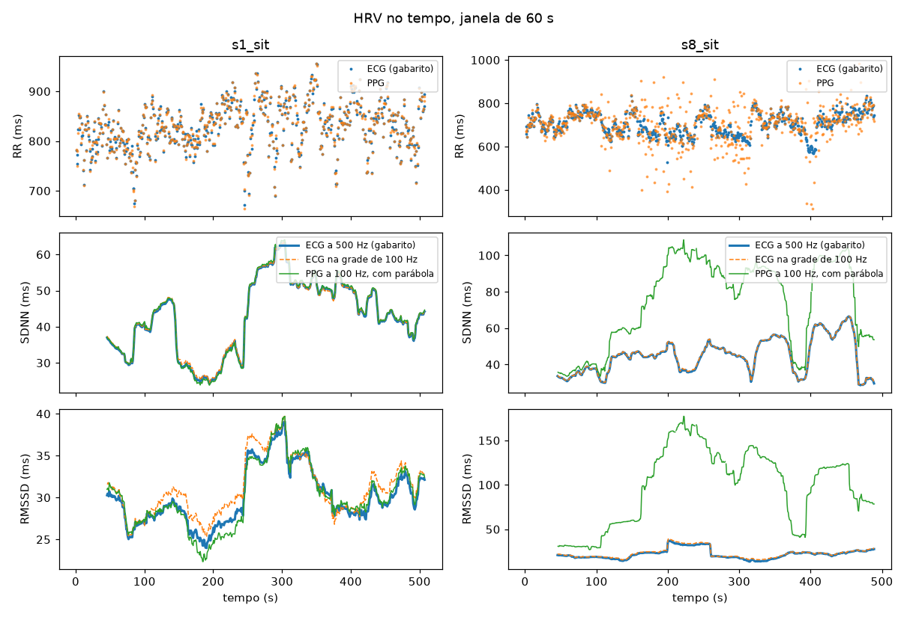

| | |
|---|---|
| Frente | B · André |
| Item do plano | 4 (Piso (tempo) e alvo (LF/HF)) |
| Entrada | ppg_batimento_t |
| Saída | ppg_hrv_t |
| Código | `Core/*/pds/hrv/` |
| Protótipo | `analise/src/analise/hrv.py` |

**O quê:** variabilidade entre batimentos: SDNN, RMSSD, LF/HF.

## Estado

Só a parte no tempo (SDNN e RMSSD). O LF/HF (na frequência) é outro item:
por enquanto `lf_hf_valido` sai sempre `false`.

| Passo | Estado |
|---|---|
| 1. Python, validado no PhysioNet | feito |
| 2. C sem HAL | feito: `hrv.h`, `hrv.c` |
| 3. Teste no PC contra os vetores | feito: `testes/hrv/`, no CI |
| 4. Placa com a fonte falsa | feito: bancada passou na STM32 (`-DBANCADA_HRV=ON`) |
| 5. Sensor real | depende do `picos/` (que ainda não existe); procedimento abaixo |

## Método

### O que é medido

O coração não bate como um metrônomo: o intervalo entre dois batimentos
(**RR**, em ms; o nome vem da onda R do ECG) muda um pouco a cada batimento,
principalmente com a respiração. Essa variação é a **HRV** (*heart rate
variability*). Duas medidas no tempo, as da Task Force de 1996:

- **SDNN:** desvio padrão dos RR da janela. Mede a variação total, lenta e
  rápida.
  $\mathrm{SDNN} = \sqrt{\frac{1}{N-1}\sum_i (RR_i - \overline{RR})^2}$.
  Divide por $N - 1$ (desvio amostral), como na Task Force e no Kubios.
- **RMSSD:** raiz da média dos quadrados das diferenças entre RR seguidos.
  Só enxerga a variação de um batimento pro próximo (a rápida, ligada ao
  nervo vago e à respiração).
  $\mathrm{RMSSD} = \sqrt{\frac{1}{M}\sum_j (RR_{j} - RR_{j-1})^2}$, com
  $M$ diferenças.

Exemplo: RR alternando 800, 850, 800, 850 ms dá RMSSD = 50 ms (toda
diferença é 50) e SDNN ≈ 25 ms.

### Janela

A cada batimento, o módulo recalcula SDNN e RMSSD com os batimentos dos
**últimos 60 s** (`HRV_JANELA_S`). A Task Force recomenda 5 min pra medida
"curta"; 60 s é o que dá pra mostrar no display sem esperar 5 min, e é o
mínimo que a literatura de "ultracurta" aceita pro RMSSD. O SDNN numa janela
de 60 s é menor que o de 5 min (não pega as variações lentas): **não compare
o nosso SDNN com tabelas de 5 min**.

Medido no PhysioNet (`uv run python -m analise.hrv --janelas`): nos 22
registros `sit`, a cada batimento depois dos primeiros 5 min, o HRV dos
últimos 60 s contra o dos últimos 5 min, os dois com o ECG exato. Mediana dos
22 (entre parênteses, o menor e o maior registro):

| Medida | 60 s − 5 min | diferença típica (RMS) | razão 60 s / 5 min |
|---|---|---|---|
| SDNN | −3,7 ms (−19,9 a +5,2) | 9,2 ms (pior 31,4) | 0,93 (0,65 a 1,06) |
| RMSSD | −0,5 ms (−10,2 a +4,3) | 2,9 ms (pior 14,0) | 0,99 (0,82 a 1,12) |

Valor de 5 min, mediana: SDNN 51,2 ms, RMSSD 33,8 ms.

- **RMSSD:** praticamente o mesmo de 5 min (razão 0,99, ~3 ms pra cima ou
  pra baixo num valor de ~34). Ele só olha batimentos vizinhos, então 60 s
  já têm diferenças suficientes.
- **SDNN:** sai ~7% menor e oscila mais (~9 ms), porque 60 s não pegam as
  variações lentas. Num registro chegou a 65% do valor de 5 min.

Pra comparação, com outras janelas (mesma conta):

| Janela | SDNN, razão | SDNN, RMS | RMSSD, razão | RMSSD, RMS |
|---|---|---|---|---|
| 30 s | 0,83 | 13,8 ms | 0,96 | 4,4 ms |
| **60 s** | **0,93** | **9,2 ms** | **0,99** | **2,9 ms** |
| 120 s | 0,97 | 6,0 ms | 1,00 | 2,0 ms |

Um batimento sai da janela quando `n_atual - n_pico >= 6000` (60 s a
100 Hz). A janela é contada pelo `n_pico`, sem a `fracao`: a diferença é de
no máximo 10 ms na borda da janela, e assim o Python e o C decidem igual,
com inteiros.

### Quais RR entram

- Só RR com `rr_valido` (o `picos/` marca `false` no primeiro batimento e
  quando perdeu um batimento no meio).
- Só RR entre **300 e 2000 ms** (200 a 30 bpm). Fora disso é erro de
  detecção, não coração. NaN e infinito também ficam de fora.
- **Um RR rejeitado quebra a sequência.** A diferença do RMSSD só existe
  entre dois RR aceitos seguidos. Sem isso, um batimento perdido viraria uma
  "diferença" enorme entre dois RR que nem são vizinhos. A diferença fica
  guardada junto do RR que a fecha: quando o RR anterior sai da janela, a
  diferença do mais antigo continua contando (uma em ~70; Python e C fazem
  igual).
- **Sem filtro de artefato** (do tipo "rejeita RR que muda mais de 20%").
  Testei no PhysioNet: ajuda pouco nos registros ruins do PPG e, nos bons,
  joga fora variação de verdade (o maior SDNN de referência caiu de 104 pra
  76 ms). Batimento falso é problema do `picos/` e do `qualidade/`.

### Quando é válido

`valido` só fica `true` quando os RR aceitos **somam pelo menos 45 s** (75%
da janela, `HRV_COBERTURA_MIN`) e há pelo menos 20 diferenças
(`HRV_MIN_DIF`). Na partida, isso dá 45 s até o primeiro valor. Com muitos
batimentos rejeitados, volta a `false` sozinho. Contar a cobertura em
segundos, e não em número de batimentos, faz a regra valer igual a 50 ou a
150 bpm.

### Casos de borda

| Situação | O que acontece |
|---|---|
| batimento com `valido` false | ignorado: `hrv_processa` devolve `false`, saída e estado intocados |
| `n_pico` menor que o anterior | reinicia (a fonte recomeçou) |
| buraco longo sem batimento | no próximo, a janela esvazia e `valido` volta a `false` |
| mais de 256 RR na janela | sai o mais antigo (não acontece com RR ≥ 300 ms) |
| `hrv_init` de novo | zera tudo |

### Implementação em C

```c
hrv_t h;                 /* ~3,3 KiB, de quem chama */
hrv_init(&h);
...
ppg_hrv_t hrv;
if (hrv_processa(&h, &batimento, &hrv) && hrv.valido) {
    /* hrv.sdnn_ms, hrv.rmssd_ms */
}
```

- Fila circular de 256 RR (`HRV_CAP`) com o `n_pico`, o RR e a diferença
  pro anterior. Cabe a janela inteira a 200 bpm.
- A cada batimento, duas passadas pela fila: a primeira soma os RR e os
  quadrados das diferenças; a segunda, os desvios da média. Somar
  $RR^2$ (~10⁶ cada) e subtrair o quadrado da média perderia em float32 os
  dígitos do desvio (~50 ms); com a média antes, não.
- Custo: no máximo 2 × 256 iterações por batimento, ~1 a 3 por segundo.

## Validação

### 1. Python no PhysioNet

`uv run python -m analise.hrv` roda os 22 registros `sit` inteiros (~8 min
cada, ~600 batimentos). O **gabarito** são os picos R do ECG a 500 Hz,
conferidos à mão no dataset, entrando no mesmo HRV com o instante exato. A
cada batimento, a saída é comparada com a do gabarito; o erro de um registro
é o RMS dessas diferenças. Mediana e pior dos 22:

| Entrada do HRV | SDNN, erro RMS | RMSSD, erro RMS | RMSSD < 5 ms |
|---|---|---|---|
| picos R na grade de 100 Hz, sem interpolar | 0,27 ms (pior 0,58) | 1,05 ms (pior 3,73) | 22 de 22 |
| picos do PPG a 100 Hz, sem interpolar | 1,59 ms (pior 35,5) | 4,88 ms (pior 87,0) | 11 de 22 |
| picos do PPG a 100 Hz, com parábola | 1,49 ms (pior 35,3) | 3,01 ms (pior 86,5) | 12 de 22 |

Referência (janela de 60 s): SDNN mediano 49,0 ms (12,3 a 104,4), RMSSD
mediano 32,7 ms (4,1 a 60,3).

- **Grade de 100 Hz (linha 1):** é o efeito só de o batimento cair numa
  amostra a cada 10 ms. O erro de arredondar o instante é uniforme em
  ±5 ms (desvio de 2,9 ms). Na diferença de dois RR seguidos entram três
  instantes, e isso soma uns $\sqrt{6} \times 2{,}9 \approx 7$ ms de ruído
  em cada diferença: o RMSSD **sobe**. Com RMSSD de 30 ms quase não aparece
  ($\sqrt{30^2 + 7^2} \approx 30{,}8$), mas no `s2_sit`, com RMSSD de 4 ms,
  vira 8 ms: é o pior caso, 3,7 ms. **Por isso o `picos/` tem que
  interpolar o pico (a `fracao`)**, ainda mais em quem tem HRV baixa.
- **PPG (linhas 2 e 3):** os picos vêm de um detector simples, feito só pra
  esta validação (passa-faixa, máximo local, parábola; o de verdade é o
  `picos/`). A onda de pulso chega ao dedo ~350 ms depois do pico R, e cada
  pico R é casado com o primeiro pico do PPG entre 100 e 600 ms depois.
  Metade dos registros fica com erro de RMSSD abaixo de 5 ms, e a parábola
  baixa a mediana de 4,9 pra 3,0 ms. A outra metade tem picos falsos ou
  trocados (entalhe dicrótico, movimento), e aí o erro vai a dezenas de ms:
  o HRV não tem como saber que um RR de 500 ms entre dois de 750 é falso.



À esquerda (`s1_sit`), as três curvas andam juntas; a da grade de 100 Hz
fica ~1 ms acima no RMSSD, como previsto. À direita (`s8_sit`), os RR do PPG
espalham (pontos laranja longe dos azuis) e o RMSSD do PPG dispara, enquanto
o do ECG fica em ~25 ms. Gerar de novo: `uv run python -m analise.plota_hrv`.

### 2. C no PC

`testes/hrv/teste_hrv.c`, no CI (`pds-host`). Vetores gerados por
`uv run python -m analise.hrv --vetores`:

| Caso | Entrada | Batimentos | Saídas válidas | Maior erro contra o Python |
|---|---|---|---|---|
| `s1_sit` | picos R do registro inteiro, com `fracao` exata | 613 | 557 | 1,5 × 10⁻⁵ ms |
| `bordas` | sintético: RR de 250 e 2600 ms, 3 perdidos seguidos, um `valido` false, `n` voltando, 90 s sem batimento, buffer cheio | 700 | 529 | 6,1 × 10⁻⁵ ms |

Tolerância de 0,01 ms. `valido` e o retorno de `hrv_processa` têm que bater
exatos. O teste também confere, no próprio C: poucos batimentos (40 s nunca
dá válido, 50 s dá), RR alternado com RMSSD exato de 50 ms, NaN, infinito,
0, 299 e 2001 ms rejeitados, batimento inválido sem efeito e reinício.
Errar de propósito pega: SDNN dividindo por $N$ (1041 falhas), diferença sem
quebrar no RR rejeitado (211), janela com `>` no lugar de `>=` (27) e sem o
descarte do buffer cheio (73).

### 3. Placa com a fonte falsa

```bash
cmake --preset Debug -DBANCADA_HRV=ON
cmake --build --preset Debug
STM32_Programmer_CLI -c port=SWD -w build/Debug/sensor-ppg.elf -v -rst
```

Na partida, logo depois de abrir a serial (antes do sensor, então roda mesmo
sem o MAX30102), a placa toca os 613 batimentos de `s1_sit` no
`hrv_processa()` e confere com o mesmo vetor do teste no PC:

```text
# bancada hrv: 613 batimentos, 557 validos, 0 fora da tolerancia, erro max 0 milesimos de ms
# bancada hrv: ciclos por batimento med 11401 max 12876 (orcamento 20000): OK
```

**Orçamento:** 20 000 ciclos por batimento (~0,2 ms a 96 MHz). A 200 bpm
são 3,3 batimentos por segundo: menos de 0,1% da CPU. O pior caso é a fila
cheia (2 × 256 iterações).

Compila com o Arm GNU com e sem a opção, sem warnings (com a bancada, flash
de ~51 KB, por causa do vetor; RAM +3,3 KB do `hrv_t`).

**Resultado na placa** (Black Pill STM32F411, build Debug `-O0`, 21/11/2026):
as duas linhas acima, exatamente. Os 613 batimentos batem com o Python
(557 saídas válidas, as mesmas do PC), com erro menor que 0,0005 ms. O custo
é de 11 401 ciclos em média e 12 876 no pior batimento: 0,13 ms a 96 MHz,
dentro do orçamento de 20 000. A 200 bpm, isso dá 0,04% da CPU. Num build
Release (`-O2`) deve cair bastante, mas não foi medido.

### 4. Sensor real

Depende do `picos/`: sem ele, não há batimento do sensor. Quando existir, a
cadeia na placa é sensor → `decimacao/` → `filtro/` → `picos/` → `hrv/`, e a
placa manda uma linha por batimento com `n_pico`, RR, SDNN e RMSSD.

Sem ECG na placa, a referência disponível é fisiológica:

1. **Repouso, 3 min sentado, respiração livre:** RMSSD tipicamente de 20 a
   60 ms em adulto jovem, SDNN da mesma ordem.
2. **Respiração guiada a 6 por minuto** (5 s inspirando, 5 s expirando),
   3 min: a HRV tem que **subir** bem (o SDNN costuma dobrar).
3. Se der, uma cinta peitoral (Polar H10 ou parecida) ao mesmo tempo, como
   gabarito de RR.

**Resultado com o sensor:** *(preencher)*
