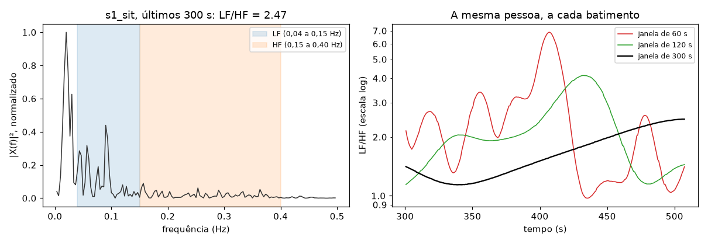

| | |
|---|---|
| Frente | B · André |
| Item do plano | 4 (Piso (tempo) e alvo (LF/HF)) |
| Entrada | ppg_batimento_t |
| Saída | ppg_hrv_t |
| Código | `Core/*/pds/hrv/` |
| Protótipo | `analise/src/analise/hrv.py` |

**O quê:** variabilidade entre batimentos: SDNN, RMSSD, LF/HF.

## Estado

Duas partes. **No tempo** (SDNN e RMSSD, `hrv.c`): feita até a placa.
**Na frequência** (LF/HF, `hrv_freq.c`): feita até a placa com a fonte falsa
(ciclos medidos em 23/11) e ligada na cadeia: sai na linha `l,` da serial e na
ficha do display, uma conta a cada 5 s, espalhada em 17 amostras. Falta a
captura com o sensor. Detalhes do LF/HF na seção [LF/HF](#lfhf-na-frequência).

| Passo | No tempo (SDNN, RMSSD) | Na frequência (LF/HF) |
|---|---|---|
| 1. Python, validado no PhysioNet | feito | feito: `hrv_freq.py` |
| 2. C sem HAL | feito: `hrv.h`, `hrv.c` | feito: `hrv_freq.h`, `hrv_freq.c` |
| 3. Teste no PC contra os vetores | feito: `testes/hrv/`, no CI | feito: `teste_hrv_freq.c`, no CI |
| 4. Placa com a fonte falsa | feito: passou na STM32 (`-DBANCADA_HRV=ON`) | feito (23/11, `-DBANCADA_HRV_FREQ=ON`): 0 fora da tolerância; pior batimento 1 284 715 ciclos em Release e 2 985 443 em Debug; a bancada da conta espalhada (acrescentada depois) falta rodar |
| 5. Sensor real | feito: a placa calcula igual ao Python; o valor fisiológico depende do suporte de dedo (abaixo) | integrado na cadeia (linha `l,`, `analise.cadeia --replay`); falta a captura de 5 min ou mais; procedimento abaixo |

## Método

### O que é medido

O coração não bate como um metrônomo: o intervalo entre dois batimentos
(**RR**, em ms; o nome vem da onda R do ECG) muda um pouco a cada batimento,
principalmente com a respiração. Essa variação é a **HRV** (*heart rate
variability*). Duas medidas no tempo, as da Task Force de 1996:

- **SDNN:** desvio padrão dos RR da janela. Mede a variação total, lenta e
  rápida.
  $\mathrm{SDNN} = \sqrt{\frac{1}{N-1}\sum_i (RR_i - \overline{RR})^2}$.
  Divide por $N - 1$ (desvio amostral), como na Task Force e no Kubios.
- **RMSSD:** raiz da média dos quadrados das diferenças entre RR seguidos.
  Só enxerga a variação de um batimento pro próximo (a rápida, ligada ao
  nervo vago e à respiração).
  $\mathrm{RMSSD} = \sqrt{\frac{1}{M}\sum_j (RR_{j} - RR_{j-1})^2}$, com
  $M$ diferenças.

Exemplo: RR alternando 800, 850, 800, 850 ms dá RMSSD = 50 ms (toda
diferença é 50) e SDNN ≈ 25 ms.

### Janela

A cada batimento, o módulo recalcula SDNN e RMSSD com os batimentos dos
**últimos 60 s** (`HRV_JANELA_S`). A Task Force recomenda 5 min pra medida
"curta"; 60 s é o que dá pra mostrar no display sem esperar 5 min, e é o
mínimo que a literatura de "ultracurta" aceita pro RMSSD. O SDNN numa janela
de 60 s é menor que o de 5 min (não pega as variações lentas): **não compare
o nosso SDNN com tabelas de 5 min**.

Medido no PhysioNet (`uv run python -m analise.hrv --janelas`): nos 22
registros `sit`, a cada batimento depois dos primeiros 5 min, o HRV dos
últimos 60 s contra o dos últimos 5 min, os dois com o ECG exato. Mediana dos
22 (entre parênteses, o menor e o maior registro):

| Medida | 60 s − 5 min | diferença típica (RMS) | razão 60 s / 5 min |
|---|---|---|---|
| SDNN | −3,7 ms (−19,9 a +5,2) | 9,2 ms (pior 31,4) | 0,93 (0,65 a 1,06) |
| RMSSD | −0,5 ms (−10,2 a +4,3) | 2,9 ms (pior 14,0) | 0,99 (0,82 a 1,12) |

Valor de 5 min, mediana: SDNN 51,2 ms, RMSSD 33,8 ms.

- **RMSSD:** praticamente o mesmo de 5 min (razão 0,99, ~3 ms pra cima ou
  pra baixo num valor de ~34). Ele só olha batimentos vizinhos, então 60 s
  já têm diferenças suficientes.
- **SDNN:** sai ~7% menor e oscila mais (~9 ms), porque 60 s não pegam as
  variações lentas. Num registro chegou a 65% do valor de 5 min.

Pra comparação, com outras janelas (mesma conta):

| Janela | SDNN, razão | SDNN, RMS | RMSSD, razão | RMSSD, RMS |
|---|---|---|---|---|
| 30 s | 0,83 | 13,8 ms | 0,96 | 4,4 ms |
| **60 s** | **0,93** | **9,2 ms** | **0,99** | **2,9 ms** |
| 120 s | 0,97 | 6,0 ms | 1,00 | 2,0 ms |

Um batimento sai da janela quando `n_atual - n_pico >= 6000` (60 s a
100 Hz). A janela é contada pelo `n_pico`, sem a `fracao`: a diferença é de
no máximo 10 ms na borda da janela, e assim o Python e o C decidem igual,
com inteiros.

### Quais RR entram

- Só RR com `rr_valido` (o `picos/` marca `false` no primeiro batimento e
  quando perdeu um batimento no meio).
- Só RR entre **300 e 2000 ms** (200 a 30 bpm). Fora disso é erro de
  detecção, não coração. NaN e infinito também ficam de fora.
- **Um RR rejeitado quebra a sequência.** A diferença do RMSSD só existe
  entre dois RR aceitos seguidos. Sem isso, um batimento perdido viraria uma
  "diferença" enorme entre dois RR que nem são vizinhos. A diferença fica
  guardada junto do RR que a fecha: quando o RR anterior sai da janela, a
  diferença do mais antigo continua contando (uma em ~70; Python e C fazem
  igual).
- **Sem filtro de artefato** (do tipo "rejeita RR que muda mais de 20%").
  Testei no PhysioNet: ajuda pouco nos registros ruins do PPG e, nos bons,
  joga fora variação de verdade (o maior SDNN de referência caiu de 104 pra
  76 ms). Batimento falso é problema do `picos/` e do `qualidade/`.

### Quando é válido

`valido` só fica `true` quando os RR aceitos **somam pelo menos 45 s** (75%
da janela, `HRV_COBERTURA_MIN`) e há pelo menos 20 diferenças
(`HRV_MIN_DIF`). Na partida, isso dá 45 s até o primeiro valor. Com muitos
batimentos rejeitados, volta a `false` sozinho. Contar a cobertura em
segundos, e não em número de batimentos, faz a regra valer igual a 50 ou a
150 bpm.

### Casos de borda

| Situação | O que acontece |
|---|---|
| batimento com `valido` false | ignorado: `hrv_processa` devolve `false`, saída e estado intocados |
| `n_pico` menor que o anterior | reinicia (a fonte recomeçou) |
| buraco longo sem batimento | no próximo, a janela esvazia e `valido` volta a `false` |
| mais de 256 RR na janela | sai o mais antigo (não acontece com RR ≥ 300 ms) |
| `hrv_init` de novo | zera tudo |

### Implementação em C

```c
hrv_t h;                 /* ~3,3 KiB, de quem chama */
hrv_init(&h);
...
ppg_hrv_t hrv;
if (hrv_processa(&h, &batimento, &hrv) && hrv.valido) {
    /* hrv.sdnn_ms, hrv.rmssd_ms */
}
```

- Fila circular de 256 RR (`HRV_CAP`) com o `n_pico`, o RR e a diferença
  pro anterior. Cabe a janela inteira a 200 bpm.
- A cada batimento, duas passadas pela fila: a primeira soma os RR e os
  quadrados das diferenças; a segunda, os desvios da média. Somar
  $RR^2$ (~10⁶ cada) e subtrair o quadrado da média perderia em float32 os
  dígitos do desvio (~50 ms); com a média antes, não.
- Custo: no máximo 2 × 256 iterações por batimento, ~1 a 3 por segundo.

## Validação

### 1. Python no PhysioNet

`uv run python -m analise.hrv` roda os 22 registros `sit` inteiros (~8 min
cada, ~600 batimentos). O **gabarito** são os picos R do ECG a 500 Hz,
conferidos à mão no dataset, entrando no mesmo HRV com o instante exato. A
cada batimento, a saída é comparada com a do gabarito; o erro de um registro
é o RMS dessas diferenças. Mediana e pior dos 22:

| Entrada do HRV | SDNN, erro RMS | RMSSD, erro RMS | RMSSD < 5 ms |
|---|---|---|---|
| picos R na grade de 100 Hz, sem interpolar | 0,27 ms (pior 0,58) | 1,05 ms (pior 3,73) | 22 de 22 |
| picos do PPG a 100 Hz, sem interpolar | 1,59 ms (pior 35,5) | 4,88 ms (pior 87,0) | 11 de 22 |
| picos do PPG a 100 Hz, com parábola | 1,49 ms (pior 35,3) | 3,01 ms (pior 86,5) | 12 de 22 |

Referência (janela de 60 s): SDNN mediano 49,0 ms (12,3 a 104,4), RMSSD
mediano 32,7 ms (4,1 a 60,3).

- **Grade de 100 Hz (linha 1):** é o efeito só de o batimento cair numa
  amostra a cada 10 ms. O erro de arredondar o instante é uniforme em
  ±5 ms (desvio de 2,9 ms). Na diferença de dois RR seguidos entram três
  instantes, e isso soma uns $\sqrt{6} \times 2{,}9 \approx 7$ ms de ruído
  em cada diferença: o RMSSD **sobe**. Com RMSSD de 30 ms quase não aparece
  ($\sqrt{30^2 + 7^2} \approx 30{,}8$), mas no `s2_sit`, com RMSSD de 4 ms,
  vira 8 ms: é o pior caso, 3,7 ms. **Por isso o `picos/` tem que
  interpolar o pico (a `fracao`)**, ainda mais em quem tem HRV baixa.
- **PPG (linhas 2 e 3):** os picos vêm de um detector simples, feito só pra
  esta validação (passa-faixa, máximo local, parábola; o de verdade é o
  `picos/`). A onda de pulso chega ao dedo ~350 ms depois do pico R, e cada
  pico R é casado com o primeiro pico do PPG entre 100 e 600 ms depois.
  Metade dos registros fica com erro de RMSSD abaixo de 5 ms, e a parábola
  baixa a mediana de 4,9 pra 3,0 ms. A outra metade tem picos falsos ou
  trocados (entalhe dicrótico, movimento), e aí o erro vai a dezenas de ms:
  o HRV não tem como saber que um RR de 500 ms entre dois de 750 é falso.


À esquerda (`s1_sit`), as três curvas andam juntas; a da grade de 100 Hz
fica ~1 ms acima no RMSSD, como previsto. À direita (`s8_sit`), os RR do PPG
espalham (pontos laranja longe dos azuis) e o RMSSD do PPG dispara, enquanto
o do ECG fica em ~25 ms. Gerar de novo: `uv run python -m analise.plota_hrv`.

### 2. C no PC

`testes/hrv/teste_hrv.c`, no CI (`pds-host`). Vetores gerados por
`uv run python -m analise.hrv --vetores`:

| Caso | Entrada | Batimentos | Saídas válidas | Maior erro contra o Python |
|---|---|---|---|---|
| `s1_sit` | picos R do registro inteiro, com `fracao` exata | 613 | 557 | 1,5 × 10⁻⁵ ms |
| `bordas` | sintético: RR de 250 e 2600 ms, 3 perdidos seguidos, um `valido` false, `n` voltando, 90 s sem batimento, buffer cheio | 700 | 529 | 6,1 × 10⁻⁵ ms |

Tolerância de 0,01 ms. `valido` e o retorno de `hrv_processa` têm que bater
exatos. O teste também confere, no próprio C: poucos batimentos (40 s nunca
dá válido, 50 s dá), RR alternado com RMSSD exato de 50 ms, NaN, infinito,
0, 299 e 2001 ms rejeitados, batimento inválido sem efeito e reinício.
Errar de propósito pega: SDNN dividindo por $N$ (1041 falhas), diferença sem
quebrar no RR rejeitado (211), janela com `>` no lugar de `>=` (27) e sem o
descarte do buffer cheio (73).

### 3. Placa com a fonte falsa

```bash
cmake --preset Debug -DBANCADA_HRV=ON
cmake --build --preset Debug
STM32_Programmer_CLI -c port=SWD -w build/Debug/sensor-ppg.elf -v -rst
```

Na partida, logo depois de abrir a serial (antes do sensor, então roda mesmo
sem o MAX30102), a placa toca os 613 batimentos de `s1_sit` no
`hrv_processa()` e confere com o mesmo vetor do teste no PC:

```text
# bancada hrv: 613 batimentos, 557 validos, 0 fora da tolerancia, erro max 0 milesimos de ms
# bancada hrv: ciclos por batimento med 11401 max 12876 (orcamento 20000): OK
```

**Orçamento:** 20 000 ciclos por batimento (~0,2 ms a 96 MHz). A 200 bpm
são 3,3 batimentos por segundo: menos de 0,1% da CPU. O pior caso é a fila
cheia (2 × 256 iterações).

Compila com o Arm GNU com e sem a opção, sem warnings (com a bancada, flash
de ~51 KB, por causa do vetor; RAM +3,3 KB do `hrv_t`).

**Resultado na placa** (Black Pill STM32F411, build Debug `-O0`, 21/11/2026):
as duas linhas acima, exatamente. Os 613 batimentos batem com o Python
(557 saídas válidas, as mesmas do PC), com erro menor que 0,0005 ms. O custo
é de 11 401 ciclos em média e 12 876 no pior batimento: 0,13 ms a 96 MHz,
dentro do orçamento de 20 000. A 200 bpm, isso dá 0,04% da CPU. Num build
Release (`-O2`) deve cair bastante, mas não foi medido.

### 4. Sensor real

A cadeia na placa é sensor → `decimacao/` → `filtro/` → `picos/` → `hrv/`.
A cada batimento do `picos/`, a placa manda a linha `p,...` (o batimento) e,
até ~1 s depois, `h,n_pico,valido,sdnn,rmssd,rr_usado` (a saída do HRV, em ms com 2 casas). O
`rr_usado` é 1 se o RR entrou no HRV e 0 se ficou de fora (trecho não usável, ver
[Qualidade](../qualidade/#o-hrv-só-com-batimentos-usáveis), ou RR já recusado pelo picos).
O `--confere` usa o
`rr_usado` pra refazer o HRV e, com `_bruto.csv` e `_filtrado.csv` de uma captura desde o
boot, refaz também a decisão no Python e compara. O `_filtrado.csv` só sai com
`-DSERIAL_COMPLETA=ON`. Conferido na placa com o `rr_usado` na pré-release da v0.3
(PR #129, `ACEITE: sim`); a captura de baixo é de antes, quando todo RR entrava.
A captura grava as duas em `_picos.csv` e `_hrv.csv`, e o Python passa os
mesmos batimentos pelo HRV dele e compara:

```bash
uv run python -m analise.captura COM3 --segundos 180   # e aperte o reset da placa
uv run python -m analise.hrv --confere dados/sensor_<data>_<hora>.csv
```

Desde o boot, toda saída tem que bater: `valido` igual e SDNN e RMSSD dentro
de 0,05 ms (a placa manda o RR e o HRV com 2 casas). A exceção é a soma dos RR
a menos de 1 ms dos 45 s da cobertura, onde as 2 casas viram o `valido`.
Capturando no meio, a comparação começa depois de uma janela inteira (60 s),
quando a janela do Python tem os mesmos batimentos que a da placa. Numa placa
simulada no PC (o `picos.c` e o `hrv.c` com as linhas do `main.c`), os 42
registros do PhysioNet deram OK desde o boot e começando no meio.

O HRV só fica válido depois de 45 s de RR aceitos. O `picos/` não sabe quando o sinal
está ruim; desde o #128, o laço deixa de fora os RR dos trechos que o `qualidade/` marca
como não usáveis (`rr_usado` = 0). Mesmo assim, a captura é em repouso, com o dedo parado:
com movimento, sobra pouco RR aceito e o HRV não chega a valer.

Isso confere a placa contra o Python. Se o valor faz sentido, sem ECG na placa,
a referência é fisiológica:

1. **Repouso, 3 min sentado, respiração livre:** RMSSD tipicamente de 20 a
   60 ms em adulto jovem, SDNN da mesma ordem.
2. **Respiração guiada a 6 por minuto** (5 s inspirando, 5 s expirando),
   3 min: a HRV tem que **subir** bem (o SDNN costuma dobrar).
3. Se der, uma cinta peitoral (Polar H10 ou parecida) ao mesmo tempo, como
   gabarito de RR.

**Resultado com o sensor** (dedo pressionado com a mão, 2 min desde o boot, 21/11/2026):

```text
captura desde o boot: 164 batimentos comparados, 52 com HRV válido
erro máximo: SDNN 0.005 ms, RMSSD 0.005 ms; valido diferente em 0 (+0 na borda da cobertura)
SDNN mediano 89.0 ms, RMSSD mediano 66.2 ms: OK
# hrv: ciclos med 3757 max 4005 (orcamento 20000)
```

A placa calcula o HRV igual ao Python em todos os batimentos (erro de 0,005
ms, o arredondamento da serial). O custo é de ~3 800 ciclos por batimento,
19% do orçamento.

O valor fisiológico ainda não é confiável: 25% dos RR saíram rejeitados, e o
RMSSD de 66 ms passa da faixa típica de repouso (20 a 60 ms), provavelmente
por batimentos falsos que sobraram. A causa é mecânica: no módulo verde
"MAX30100/30102", os capacitores e reguladores em volta do sensor são mais
altos que a janela dele. Com o dedo apoiado de leve, ele não encosta na
janela e o pulso some; pressionando com a mão, o pulso aparece (autocorrelação
de 0,5 a 0,6 a ~70 bpm em 20 s), mas ninguém segura a pressão constante por
minutos. Em capturas de 2 a 3 min com o dedo solto, só 45 a 52% dos RR saíram
válidos e o HRV nunca ficou válido. **O projeto precisa de um suporte que
segure o dedo sobre o sensor com pressão leve e constante** (como um
oxímetro de dedo); com ele, a captura de repouso e a de respiração guiada
abaixo valem como validação fisiológica.

## LF/HF (na frequência)

### O que é medido

Olhe a sequência de RR como um **sinal no tempo**: ela sobe e desce em
"ritmos". Dois deles interessam (Task Force de 1996):

- **HF** (*high frequency*), **0,15 a 0,40 Hz**: um ciclo a cada 2,5 a 7 s.
  É a respiração: o coração acelera ao inspirar e desacelera ao expirar
  (arritmia sinusal respiratória, ligada ao nervo vago).
- **LF** (*low frequency*), **0,04 a 0,15 Hz**: um ciclo a cada 7 a 25 s.
  Ligado ao barorreflexo (o ajuste da pressão), com simpático e vago
  misturados.

**LF/HF** é a razão entre a potência (o "tamanho ao quadrado" da oscilação)
das duas faixas. Foi proposto como índice do equilíbrio simpático-vagal, mas
essa leitura é contestada: o LF não é "só simpático". Use como indicador
grosseiro, e só comparando a mesma pessoa em condições diferentes.

Exemplo: se o RR oscila ±40 ms a 0,1 Hz e ±20 ms a 0,25 Hz, LF/HF ≈
(40/20)² = 4 (o teste em C confere isso: dá 4,07).

### Método

A cada batimento, com os RR aceitos dos **últimos 300 s**:

1. **Pontos irregulares.** Cada RR fica no instante do batimento que o
   fecha. Os batimentos não chegam a intervalos regulares, e a DFT precisa
   de amostras regulares.
2. **Spline cúbica natural e reamostragem a 2 Hz.** Uma curva suave passa
   por todos os pontos (cada trecho entre dois batimentos é um polinômio de
   grau 3; nas pontas, curvatura zero: "natural") e é lida a cada 0,5 s.
   Vira um sinal regular de até 601 amostras.
3. **Tira a reta e aplica a janela de Hann.** A reta (tendência linear dos
   300 s) e as variações mais lentas que 0,04 Hz não são LF nem HF; sem
   tirar, vazam pra dentro do LF. A janela de Hann (um "sino" que vai a
   zero nas pontas) diminui esse vazamento entre frequências.
4. **DFT só onde interessa.** A grade de frequências é $f_k = k/300$ Hz
   (a resolução de uma janela de 300 s). LF são os $k$ de 12 a 44, HF de 45
   a 120: 109 frequências. Para cada uma, $|X(f_k)|^2$; somando, a potência
   de cada banda. **LF/HF = LF / HF**: as escalas (ms², número de amostras)
   se cancelam na razão.

Cada escolha foi medida no PhysioNet (`uv run python -m analise.hrv_freq
--metodos`): 22 registros `sit`, janela de 300 s, ECG exato, a cada 5
batimentos. Razão da outra conta contra a nossa:

| Conta | razão, mediana | faixa (5% a 95%) |
|---|---|---|
| spline a 4 Hz (em vez de 2 Hz) | 1,000 | 1,00 a 1,00 |
| interpolação linear (em vez de spline) | 1,218 | 1,06 a 1,42 |
| periodograma nos bins da FFT, a 4 Hz (receita de livro) | 1,003 | 1,00 a 1,02 |
| Lomb-Scargle (sem reamostrar) | 1,020 | 0,61 a 1,46 |

- **2 Hz basta.** A banda vai até 0,4 Hz; pela amostragem (Nyquist), 0,8 Hz
  já bastaria. 4 Hz (o padrão do Kubios) dá o mesmo número com o dobro de
  conta e de memória.
- **Spline, não reta.** Ligar os pontos com retas é um filtro passa-baixa:
  atenua a HF (a respiração) e infla o LF/HF em ~22% (até 42%).
- **A nossa grade bate com a receita de livro** (periodograma da FFT): 0,3%.
- **Lomb-Scargle** calcula o espectro direto dos pontos irregulares, sem
  reamostrar. Na mediana, dá o mesmo; num batimento qualquer, pode dar 40%
  a mais ou a menos. Isso mostra o tamanho da incerteza **do próprio
  método**: dois jeitos aceitos de calcular o LF/HF discordam desse tanto.

### A janela: por que 300 s

A banda LF é lenta: um ciclo de 0,04 Hz dura 25 s. Uma janela de 60 s tem
só 2 a 9 ciclos de LF, e a resolução de frequência é $1/60 \approx
0{,}017$ Hz: a banda LF inteira (0,04 a 0,15 Hz) vira ~6 pontos do
espectro. A Task Force pede ~2 min pro LF e padroniza 5 min.

Medido (`uv run python -m analise.hrv_freq --janelas`): a cada 5
batimentos depois de 300 s de registro, o LF/HF das janelas curtas contra o
de 300 s, no mesmo instante, com o ECG exato. "Fator" = quantas vezes um
difere do outro (2 = metade ou o dobro):

| Janela | fator típico (mediana dos 22) | pior registro | 1 em 10 passa de |
|---|---|---|---|
| 60 s | 1,76 | 2,49 | 3,16 |
| 120 s | 1,47 | 2,97 | 2,12 |
| 180 s | 1,28 | 2,28 | 1,60 |

LF/HF de 300 s nos registros: mediana 3,2 (0,34 a 11,1).



À esquerda, o espectro dos últimos 300 s de `s1_sit`: o maior pico fica
abaixo de 0,04 Hz (fora das duas bandas; é por isso que tirar a reta e usar
Hann importam). À direita, a mesma pessoa, sentada: com 60 s, o LF/HF anda
de 1 a 7 em dois minutos; com 300 s, de 1,1 a 2,5, devagar.

**Conclusão:** numa janela de 60 s, o LF/HF erra tipicamente por um fator
de 1,8 (e 1 vez em 10 por mais de 3): **não é confiável, no máximo
indicativo**. Mesmo 120 s ainda erra por ~1,5. Por isso a janela é de
**300 s**. O que isso custa:

- **Atraso:** o primeiro LF/HF sai depois de os RR aceitos somarem 270 s
  (`HRV_FREQ_COBERTURA_MIN` = 90% da janela): **~4,5 min** depois de pôr o
  dedo (o SDNN e o RMSSD saem com 45 s). Depois, na cadeia, um valor novo a
  cada 5 s (ver [Na cadeia](#na-cadeia-a-cada-5-s-espalhado)): ele muda devagar.
- **Memória:** `hrv_freq_t` tem **~16,4 KiB** (600 RR com `n_pico`,
  `fracao` e RR numa fila circular, mais a área de trabalho da spline e a série de 601
  amostras). O `hrv_t` do tempo tem 3,3 KiB. A F411 tem 128 KiB. Medido pelo
  linker (24/11, já com a SpO2 na cadeia): ligar o LF/HF na cadeia levou a RAM de
  40 392 para 57 264 B (+16 872) e a flash de 61 264 para 63 344 B em Release
  (Debug: 40 400 → 57 272 B de RAM, 89 996 → 94 048 B de flash).
- **Batimentos rápidos:** cabem 600 RR. Acima de ~120 bpm de média em
  5 min, o buffer descarta os mais antigos, a cobertura cai abaixo de 90% e
  o LF/HF fica inválido. Em repouso (o caso que interessa) não acontece.

Mesmo em 300 s o LF/HF **não é um número preciso** (a tabela de métodos
mostra ±40% entre contas aceitas). Serve pra comparar a mesma pessoa em
duas condições (repouso e respiração guiada, por exemplo), não pra comparar
com tabelas.

### Quais RR entram e quando é válido

As mesmas regras do HRV no tempo: `rr_valido`, 300 a 2000 ms, NaN e
infinito fora, janela pelo `n_pico` (sai quando `n_atual - n_pico >=
30000`). A mais: um RR no **mesmo instante** do último guardado (mesmo
`n_pico` e `fracao`) não entra, porque a spline dividiria por zero.

`lf_hf_valido` só quando os RR aceitos **somam pelo menos 270 s**. Não há um
mínimo de pontos à parte (havia um, `HRV_FREQ_MIN_RR` = 4, e foi tirado: era
redundante): 270 s de RR de no máximo 2000 ms já são pelo menos 135 pontos na
spline. Um batimento perdido tira **dois** RR (o dele e o seguinte,
que chega com `rr_valido` false): a spline passa por cima do buraco, mas com
mais de ~1 perdido a cada 20 batimentos a cobertura cai abaixo de 90% e o
LF/HF fica inválido. No teste, 1 perdido a cada 40 muda o LF/HF em 9%.

| Situação | O que acontece |
|---|---|
| menos de 270 s de RR | `lf_hf_valido` false, `lf_hf` = 0 |
| batimento com `valido` false | ignorado: devolve `false`, saída e estado intocados |
| `n_pico` menor que o anterior | reinicia |
| buraco longo sem batimento | a janela esvazia e volta a inválido |
| mais de 600 RR na janela | sai o mais antigo |
| `hrv_freq_init` de novo | zera tudo (e larga uma conta espalhada em andamento) |
| `n_pico` voltando no meio de uma conta espalhada | reinicia e larga a conta: não sai resultado |

### Implementação em C

```c
hrv_t h;               /* ~3,3 KiB */
hrv_freq_t hf;         /* ~16,4 KiB: static, não na pilha */
hrv_init(&h);
hrv_freq_init(&hf);
...
ppg_hrv_t hrv;
if (hrv_processa(&h, &batimento, &hrv)) {   /* escreve lf_hf_valido = false */
    hrv_freq_processa(&hf, &batimento, &hrv); /* DEPOIS: preenche lf_hf */
}
```

Esse é o jeito "de uma vez": a conta inteira a cada batimento (13,4 ms em
Release, 31 ms em Debug no pior caso, medidos). A cadeia usa o jeito
**espalhado**, com a mesma conta em pedaços:

```c
hrv_freq_guarda(&hf, &batimento);      /* a cada batimento: só guarda o RR */
...
hrv_freq_comeca(&hf);                  /* quando quiser um valor */
...                                    /* depois, uma vez por amostra: */
if (hrv_freq_passo(&hf, &hrv)) {       /* true no 17º passo */
    /* hrv.lf_hf_valido e hrv.lf_hf prontos */
}
```

- **A janela** é a dos 300 s que terminam no **último batimento guardado**
  (com `valido` true), não no `n` atual: `hrv_freq_comeca()` calcula sobre o
  que já está guardado. Assim, o número é exatamente o que
  `hrv_freq_processa()` daria naquele batimento, e as regras são as do HRV no
  tempo (que também só anda com batimento). Sem batimento nenhum, a janela não
  anda e o último valor fica.
- **`hrv_freq_guarda()`** só escreve o RR numa fila circular (como o `hrv_t`)
  e anda o início pelos que saíram da janela: nenhum vetor é movido, e o custo
  é constante por RR que entra ou sai (algumas centenas de ciclos, estimado; a
  bancada mede o pior). A primeira versão guardava os RR contíguos e, com a
  janela cheia, tirava o mais antigo com 3 `memmove` de ~1,4 KB cada (o do
  newlib-nano vai byte a byte): ~30 a 40 mil ciclos por batimento, estimados,
  dentro da medida `hrv` da cadeia (orçamento 20 000).
- **`hrv_freq_comeca()`** confere a cobertura e copia os instantes e os RR
  pra área de trabalho, desembrulhando a fila (do mais antigo ao mais novo, a
  partir do índice 0; duas passadas nos ≤ 600 RR). Os batimentos guardados
  durante a conta não mexem nela. A ordem das somas é a mesma da versão
  contígua: o resultado é igual bit a bit.
- **`hrv_freq_passo()`**, `HRV_FREQ_PASSOS` = 17 vezes: (1) spline; (2)
  reamostragem; (3) reta e Hann; (4 a 17) o Goertzel, 8 das 109 frequências por
  passo (`HRV_FREQ_K_POR_PASSO`). O 17º solta o resultado. São sempre 17, mesmo
  sem cobertura (aí os passos não fazem nada e sai inválido): o resultado sai
  numa amostra previsível, que o Python repete.
- **Igual bit a bit:** `hrv_freq_processa()` é `guarda` + `comeca` + os 17
  passos seguidos, então as duas formas fazem as mesmas operações de float na
  mesma ordem (as somas das bandas também vão na ordem de *k*). O
  `teste_hrv_freq` confere a igualdade bit a bit em 152 contas dos dois vetores,
  com batimentos guardados no meio da conta, e que o resultado sai no 17º passo.
- **Pior passo (estimativa):** 8 das 109 frequências são ~7% da conta inteira
  medida: ~200 mil ciclos em Debug (~2 ms) e ~90 mil em Release (~1 ms). A
  proporção vem de medir cada passo no PC (cada passo do Goertzel é ~9,4% do
  total em `-O0`; os 3 primeiros, 1,5 a 2%); na placa, os `cosf` da Hann pesam
  mais, mas ainda abaixo de um passo do Goertzel. A bancada mede (abaixo).

`hrv_freq.c` é um arquivo ao lado do `hrv.c` no mesmo módulo, com estado
próprio: o LF/HF precisa de 300 s e o SDNN/RMSSD de 60 s, e assim a bancada
de um não muda o orçamento do outro. Ele preenche só `lf_hf_valido` e
`lf_hf` de `ppg_hrv_t` (o `ppg.h` não mudou: os campos já existiam).

- **Spline:** sistema tridiagonal resolvido pelo algoritmo de Thomas (uma
  ida e uma volta, ~600 passos). Antes, tira a média dos RR (números
  pequenos em float32; a reta sai depois de qualquer jeito).
- **Tempo relativo:** o instante de cada RR é calculado como
  `(n - n_primeiro) + (fracao - fracao_primeiro)`, subtraindo os inteiros
  antes de virar float. `n_pico / 100` direto em float32 perderia os
  milissegundos depois de ~2 dias de `n`.
- **DFT por Goertzel** (`hrv_freq_potencias()`): pra cada frequência, um
  ressonador de 2ª ordem $s_j = y_j + 2\cos\omega\, s_{j-1} - s_{j-2}$, e
  no fim $|X|^2 = s_1^2 + s_2^2 - 2\cos\omega\, s_1 s_2$. Uma
  multiplicação por amostra, sem tabela de senos. 109 frequências × ~600
  amostras ≈ 65 mil iterações por conta.
- **Trocável por FFT:** `hrv_freq_potencias(y, n, &lf, &hf)` recebe a série
  pronta e devolve as duas potências. Com o CMSIS-DSP (#25), dá pra trocar
  por uma FFT real de 1024 pontos sem mexer no resto.

Por que não as outras opções em C puro:

| Opção | Conta por batimento | Memória extra | Por que não |
|---|---|---|---|
| **Spline + Goertzel (escolhida)** | ~65 mil mult. + spline | série de 601 floats | — |
| Spline + DFT completa (601 bins) | ~360 mil mult. complexas | igual | 5× mais conta pra jogar fora 80% dos bins |
| FFT (CMSIS-DSP) | ~20 mil | 1024 floats | depende da #25, que ainda não existe |
| Lomb-Scargle direto | ~109 × 360 × 4 senos/cossenos (~150 mil `sinf`) | nenhuma série | ~10× mais lento e não vira FFT depois |
| Interpolação linear + Goertzel | igual à escolhida | menos 2 vetores | infla o LF/HF em 22% (medido) |

### Validação do LF/HF

#### Na cadeia: a cada 5 s, espalhado

Na cadeia (`pds/cadeia/cadeia.c`), cada batimento que vai pro HRV no tempo
também é guardado no LF/HF (`hrv_freq_guarda`), com o **mesmo `rr_valido`** (o
`rr_usado`, que já passou pela qualidade). A conta começa a cada 5 s, na amostra
de `n % 500 == 20`, e anda um passo por amostra (21 a 37); o resultado sai na de
`n % 500 == 37`, vai pra ficha (`hrv.lf_hf_valido`, `hrv.lf_hf`, que o display já
lê) e pra serial na linha `l,n,valido,lf_hf` (3 casas). Por quê:

- **Uma conta a cada 5 s, e não a cada batimento:** o LF/HF de 300 s muda
  devagar, e a conta inteira custa 13,4 ms (Release) ou 31 ms (Debug) no pior
  batimento: junto da amostra mais pesada (16 a 19 ms de volta em Release, 26 ms
  em Debug), estouraria a folga de 37,5 ms do sensor depois do INT.
- **Espalhada em 17 amostras:** o pior passo fica em ~2 ms em Debug (estimado),
  bem abaixo de 5 ms.
- **`n % 500 == 20`:** longe da amostra de `n % 100 == 99`, onde a qualidade
  julga (e solta os batimentos da fila do HRV, até 2 numa amostra), a FFT do
  espectral e a respiração calculam. A placa processa as amostras em lotes de 4
  ou 5: com os passos de 21 a 37, nenhum cai no lote da amostra pesada. A conta
  pega os batimentos soltos no julgamento de 0,2 s antes.
- **A ficha não perde o LF/HF:** `hrv_processa()` escreve `lf_hf_valido =
  false` na saída dele; a cadeia copia pra ficha só `valido`, `sdnn_ms` e
  `rmssd_ms`, e o LF/HF da ficha é sempre o da última conta.

O `teste_cadeia` confere tudo contra a referência em Python
(`analise.cadeia`, mesma ordem e mesma cadência): no vetor de 90 s, as 18 contas
(todas inválidas: 90 s não chegam aos 270 s de RR) e, num vetor longo (320 s de
`s1_sit` desde o começo, `testes/cadeia/vetores/longo.h`, só com as saídas do
LF/HF), as 64 contas, 8 delas válidas (LF/HF de 1,1 a 1,3; maior erro contra o
Python 2 × 10⁻⁶), e a ficha em toda amostra. Errar de propósito pega: não guardar
no LF/HF (8 válidas viram inválidas), a ficha sem o `lf_hf` ou copiando a saída
inteira do `hrv_processa` (a ficha perde o valor), guardar com `rr_valido`
sempre true (7 fora da tolerância) e a fase errada (todos os `n`).

#### 1. Python no PhysioNet

`uv run python -m analise.hrv_freq` roda os 22 registros `sit` inteiros. O
gabarito é o mesmo módulo (`HrvFreq`) com os picos R do ECG a 500 Hz no
instante exato. Erro de um registro: o fator típico (mediana) entre a saída
e o gabarito, nos batimentos em que os dois são válidos:

| Entrada | fator de erro, mediana | pior registro | registros abaixo de 1,2 | saídas válidas |
|---|---|---|---|---|
| picos R na grade de 100 Hz, sem interpolar | 1,022 | 1,21 | 21 de 22 | 6258 de 6258 |
| picos do PPG a 100 Hz, sem interpolar | 1,136 | 7,62 | 13 de 22 | 5848 de 6258 |
| picos do PPG a 100 Hz, com parábola | 1,086 | 7,58 | 13 de 22 | 5858 de 6258 |

- **Grade de 100 Hz:** erro de 2%, sem sentido fixo (em alguns registros
  pra cima, em outros pra baixo). O ruído de ±5 ms do arredondamento é
  pequeno perto das oscilações de dezenas de ms que o LF/HF mede. Ao
  contrário do RMSSD, aqui a `fracao` do `picos/` quase não faz diferença.
- **PPG:** com o detector simples de validação (o mesmo do HRV no tempo; o
  de verdade é o `picos/`), metade dos registros fica com erro abaixo de
  20%, e a parábola ajuda (14% → 9% na mediana). Nos registros com picos
  falsos, o erro chega a um fator de 7,6: um pico falso cria um par de RR
  curto-longo, que é uma oscilação rápida falsa (vai pra HF ou acima).
  Problema do `picos/` e do `qualidade/`, como no SDNN/RMSSD.

#### 2. C no PC

`testes/hrv/teste_hrv_freq.c`, no CI. Vetores gerados por
`uv run python -m analise.hrv_freq --vetores`:

| Caso | Entrada | Batimentos | Saídas válidas | Maior erro contra o Python |
|---|---|---|---|---|
| `freq_s1_sit` | picos R do registro inteiro, com `fracao` exata | 613 | 283 | 1,6 × 10⁻⁵ |
| `freq_bordas` | sintético (senoides em LF e HF): RR de 250 e 2600 ms, 3 perdidos, um `valido` false, `n` voltando, 400 s sem batimento, ~158 bpm enchendo o buffer | 2469 | 1285 | 9,9 × 10⁻⁵ |

Tolerância de 0,002 no LF/HF; `lf_hf_valido` e o retorno exatos. O teste
também confere, no C: senoide num bin exato cai inteira na banda certa
($|X|^2 = (N/2)^2$), senoides conhecidas dão LF/HF ≈ 4, janela incompleta
(inválido até ~270 s), 1 perdido em 40 (muda < 10%) e em 20 (inválido),
poucos batimentos, batimento inválido, RR no mesmo instante, reinício, o
encadeamento `hrv_processa` → `hrv_freq_processa` e a conta espalhada (igual bit
a bit, 17 passos, passo sem conta não mexe na saída). O teste de reinício confere
que uma conta espalhada em andamento é largada quando o `n_pico` volta: só a
janela não bastava pra pegar a falta do `hrv_freq_init()` no reinício, porque
`n_pico - n[i]` dá a volta no `uint32_t` e esvazia a janela sozinho. Errar de
propósito pega:
spline virando reta (1568 falhas), sem tirar a reta (65), sem Hann (1558),
0,15 Hz contado no LF (1483), janela com `>` (6) e buffer cheio sem
descartar (350).

#### 3. Placa com a fonte falsa

```bash
cmake --preset Release -DBANCADA_HRV_FREQ=ON   # e de novo com Debug
cmake --build --preset Release
STM32_Programmer_CLI -c port=SWD -w build/Release/sensor-ppg.elf -v -rst
```

Na partida, logo depois de abrir a serial (antes do sensor), a placa toca
os 613 batimentos de `s1_sit` no `hrv_freq_processa()`, confere com o mesmo
vetor do teste no PC e mede os ciclos de cada batimento. A cada 10 batimentos
(`BANCADA_HRV_FREQ_CADA`), faz a mesma conta espalhada (`hrv_freq_comeca` e os
17 `hrv_freq_passo`, como na cadeia), confere que deu o mesmo float e mede o
pior passo. Depois, roda os 613 batimentos de novo só no `hrv_freq_guarda` (o
que a cadeia faz a cada batimento) e mede o pior, à parte o dos batimentos com a
janela cheia (os que tiram RR da janela: 242 em `s1_sit`). Esperado:

```text
# bancada lf/hf: 613 batimentos, 283 validos, 0 fora da tolerancia, erro max ... milionesimos
# bancada lf/hf: ciclos por batimento med ... max ... (orcamento 1500000)
# bancada lf/hf: guarda max ..., com a janela cheia ... em 242 batimentos (orcamento 2000)
# bancada lf/hf: espalhada em 17 passos, 62 contas, 0 diferentes; pior passo ..., comeca ... (orcamento 160000): OK
```

**Orçamento, por perfil** (`bancada_hrv.h`; o Release é `-Os`, que define
`__OPTIMIZE__`):

| | Release | Debug (`-O0`) |
|---|---|---|
| Conta inteira, pior batimento (medido, 23/11) | 1 284 715 (13,4 ms) | 2 985 443 (31 ms) |
| Orçamento da conta inteira | 1 500 000 | 3 400 000 |
| Pior passo da conta espalhada (estimado) | ~90 000 (~1 ms) | ~200 000 (~2 ms) |
| Orçamento do passo | 160 000 (1,7 ms) | 320 000 (3,3 ms) |
| Pior `hrv_freq_guarda` (estimado) | algumas centenas | algumas centenas |
| Orçamento da guarda (10% dos 20 000 do HRV) | 2 000 | 2 000 |

O orçamento antigo era um só, 2 000 000, estimado sem medir pra `-O0`: o Debug
medido passou dele (31 ms). A média por batimento que a bancada imprime ("med")
inclui os ~270 primeiros batimentos, em que a janela ainda não cobre e não há
conta; por isso ela é perto da metade do máximo (587 395 em Release e 1 368 224
em Debug).

**Resultado na placa** (23/11/2026, a bancada de antes da conta espalhada): 283
válidos, 0 fora da tolerância, erro máximo 14 milionésimos; pior batimento
1 284 715 ciclos em Release (13,4 ms a 96 MHz) e 2 985 443 em Debug (31 ms);
média 587 395 e 1 368 224. É por esses números que, na cadeia, a conta vai espalhada e
só a cada 5 s. **Falta rodar** a bancada nova (a terceira e a quarta linhas,
com a guarda e o pior passo).

Com a bancada do LF/HF ligada, compila sem warnings: Release 81 556 B de flash e
74 112 B de RAM; Debug 115 336 e 74 120 (o `hrv_freq_t` da bancada é outro, além
do da cadeia; medido em 24/11, já com a SpO2 na cadeia).

Passos: (1) gravar com a opção; (2) abrir a serial a **460800** e copiar as
quatro linhas; (3) conferir `0 fora da tolerancia`, `283 validos` e `0 diferentes`;
(4) anotar os ciclos aqui; (5) voltar com `-DBANCADA_HRV_FREQ=OFF`.

#### 4. Sensor real

Depende do `picos/`, como o SDNN/RMSSD. Sem ECG na placa, o teste é
fisiológico, e precisa de **pelo menos 5 min por condição**, mais os
~4,5 min até o primeiro valor:

Grave com `uv run python -m analise.captura <porta> --qualidade` (o LF/HF vai
pro `<nome>_lfhf.csv`, um valor a cada 5 s) e confira com
`uv run python -m analise.cadeia --replay`, que refaz as linhas `l,` no PC.

1. **Repouso sentado, respiração livre, 8 min:** anotar o LF/HF dos
   últimos 3 min. Varia muito entre pessoas: nos 22 registros sentados do
   PhysioNet, de 0,34 a 11 (mediana 3,2).
2. **Respiração guiada a 6 por minuto (0,1 Hz), 8 min:** a respiração cai
   **dentro da banda LF**, e o LF/HF tem que **subir muito** (fator de 3 ou
   mais). É o teste mais claro, porque o efeito é grande e previsível.
3. **Respiração guiada a 15 por minuto (0,25 Hz), 8 min:** a respiração
   fica na HF; o LF/HF tem que **cair** em relação ao item 2.
4. Se der, uma cinta peitoral ao mesmo tempo, como gabarito de RR.

**Resultado com o sensor:** *(preencher)*
