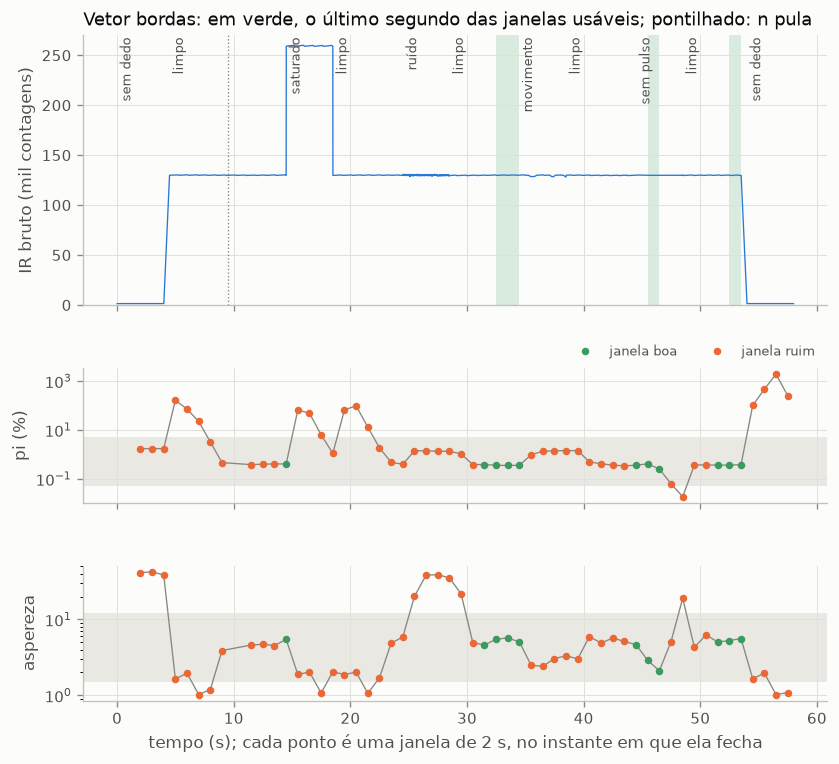

| | |
|---|---|
| Frente | B · André |
| Item do plano | 7 (Piso) |
| Entrada | bruto |
| Saída | ppg_qualidade_t |
| Código | `Core/*/pds/qualidade/` |
| Protótipo | `analise/src/analise/qualidade.py` |

**O quê:** detectar dedo ausente ou mal posicionado e marcar janela inválida.

## Estado

| Passo | Estado |
|---|---|
| 1. Python, validado no PhysioNet | feito |
| 2. C sem HAL | feito: `qualidade.h`, `qualidade.c` |
| 3. Teste no PC contra os vetores | feito: `testes/qualidade/`, no CI |
| 4. Placa com a fonte falsa | feito: a bancada passou na placa |
| 5. Sensor real | feito: a placa decide igual ao Python; mas com este módulo de sensor ela aceita trechos sem pulso de verdade (abaixo) |

## Método

### O problema

O laço principal precisa saber quando **não** confiar no sinal: sem dedo, o
sensor lê ~1500 contagens de luz que vaza; com o dedo mexendo, o movimento
gera ondas maiores que o próprio pulso (vimos isso no relatório 1), e o
`picos/` acharia batimentos falsos. O detector olha o **bruto** (com DC),
porque o nível DC é justamente o que diz se há dedo, e solta uma resposta por
segundo: dá pra usar os últimos 2 s ou não.

### Janela de 2 s, uma resposta por segundo

As amostras chegam a 100 Hz. O módulo acumula **blocos de 1 s** e, no fim de
cada bloco, julga a **janela** formada pelo bloco anterior e o atual (2 s).
Por que 2 s: a janela precisa ter pelo menos um batimento inteiro pra medir a
altura do pulso, e a 30 bpm um batimento dura 2 s. Janela maior demora mais
pra perceber o defeito e mistura trecho bom com ruim.

Tudo é acumulado amostra a amostra (soma, máximo, mínimo, soma de
diferenças), sem guardar as 200 amostras: o estado inteiro tem 108 bytes e o
custo por amostra é de umas poucas somas e comparações. Só a amostra que
fecha o bloco faz 5 divisões.

### O passa-altas

O IR bruto tem o DC (~130 mil), a respiração e derivas lentas (0,1 a
0,3 Hz) e o pulso (~1 Hz, 0,2 a 2% do DC). Pra medir só o pulso, o módulo
tira do IR uma **média exponencial**:

$m[n] = m[n-1] + \alpha\,(x[n] - m[n-1])$, $\quad y[n] = x[n] - m[n]$, $\quad \alpha = 0{,}02$

$m$ é uma média que "esquece" o passado devagar (constante de tempo
$1/(\alpha f_s) = 0{,}5$ s); $y$ é o que sobra quando se tira essa média: um
passa-altas de 1ª ordem com corte em
$f_c = \alpha f_s / 2\pi \approx 0{,}32$ Hz. Passa o pulso (0,5 a 3 Hz) e
corta quase todo o DC e a deriva. Custa uma multiplicação e duas somas por
amostra. Sem ele (testado com $\alpha = 0$, que mede a altura direto no
bruto), a deriva da respiração entra na altura: o falso alarme no limpo
triplica (1,0% das janelas contra 0,3%) e o dedo sem pulso passa mais (12,9%
das janelas contra 7,5%).

### Os indicadores de cada janela

| Indicador | Conta | O que mostra |
|---|---|---|
| `dc` | média do bruto, IR e vermelho | se há dedo |
| `maior` | maior amostra bruta dos dois canais | se o ADC saturou |
| `altura` | máx(y) − mín(y) | o tamanho do pulso, em contagens |
| `pi` | altura / dc do IR | **índice de perfusão**: o pulso em % do nível |
| `aspereza` | Σ\|y[n] − y[n−1]\| / altura | quantas "alturas" o sinal percorre: um pulso limpo sobe e desce ~uma vez por batimento (4 a 7 numa janela de 2 s); ruído sobe e desce toda amostra (> 20) |
| `razao` | altura / altura de referência | se o pulso mudou de tamanho de repente |

A **altura de referência** é uma média das alturas das últimas janelas boas
(cada janela boa puxa a referência 1/4 do caminho até ela). Ela só aprende
com janela boa e é **esquecida** depois de 10 janelas ruins seguidas, porque
o pulso pode ter mudado de verdade (o dedo mudou de posição e ficou bom de
novo).

### A regra e os limiares

Uma janela é **boa** quando passa em tudo. Cada falha liga um bit em
`qualidade_t.motivo`, pra serial e o display explicarem o porquê:

| Critério | Limiar | Motivo | De onde vem o número |
|---|---|---|---|
| dc dos dois canais ≥ | 10 000 contagens | `SEM_DEDO` | Sem dedo o sensor lê ~1500; com dedo, 64 mil a 87 mil no PhysioNet e ~130 mil no nosso. 10 mil é a média geométrica de 1500 e 65 mil (folga de ~6× pros dois lados). |
| maior < | 250 000 | `SATURADO` | ~95% do topo do ADC de 18 bits (262 143). Perto do topo o pulso é cortado. |
| pi ≥ | 0,05% | `PULSO_FRACO` | Menor pi limpo do PhysioNet: 0,09%. Metade disso. |
| razao ≥ | 0,4 | `PULSO_FRACO` | Pulso que cai a menos de 40% de repente: dedo apertado demais ou saindo. No limpo, só 1% das janelas fica abaixo de 0,53. |
| pi ≤ | 5% | `MOVIMENTO` | Maior pi limpo do PhysioNet: 5,0%; 99% ficam abaixo de 2,9%. |
| razao ≤ | 2,0 | `MOVIMENTO` | O pulso não dobra de um segundo pro outro; o movimento, sim. No limpo, 99,9% ficam abaixo de 2,3 contra a mediana das janelas anteriores. |
| aspereza ≥ | 1,5 | `MOVIMENTO` | Abaixo disso o sinal só subiu ou só desceu na janela: deriva ou transitório (o dedo acabou de entrar), não pulso. Menor aspereza limpa: 1,97. |
| aspereza ≤ | 12 | `RUIDO` | Maior aspereza limpa: 10,5. Ruído de metade do tamanho do pulso já dá aspereza mediana de 22. |

Os limiares saíram da distribuição dos indicadores nos 22 registros `sit` do
PhysioNet (10 783 janelas limpas) contra os defeitos fabricados (abaixo):
cada um fica fora da faixa do sinal limpo, com folga.

### Histerese: rejeita rápido, aceita devagar

`indice` = janelas boas seguidas / 3, limitado a 1. **Uma janela ruim zera.**
`usavel` = `dedo_presente` e `indice` ≥ 1, ou seja, **3 janelas boas
seguidas** (`QUALIDADE_JANELAS_ACEITA`). Assim um sinal que pisca entre bom e
ruim fica marcado como ruim o tempo todo, e um defeito curto tira o sinal do
ar por pelo menos 3 s. Errar pro lado de descartar é mais barato: perder
alguns segundos de BPM é melhor que mostrar um BPM falso ou estragar o HRV.

### A saída

Uma por segundo (`qualidade_processa` devolve `true`), a partir do segundo
segundo:

| Campo | Significado |
|---|---|
| `valido` | a janela de 2 s encheu (desde o início ou o último reinício) |
| `dedo_presente` | dc dos dois canais ≥ 10 000 |
| `indice` | 0, 1/3, 2/3 ou 1 |
| `usavel` | `dedo_presente` e `indice` ≥ `QUALIDADE_LIMIAR` (1) |

A resposta vale para **os últimos 2 s**: o laço principal tem que descartar
os batimentos desse trecho, não só os que vierem depois.

### Casos de borda

| Situação | O que acontece |
|---|---|
| primeiras 199 amostras | nada sai (`processa` devolve `false`, `*s` intocado) |
| `n` que não é o seguinte do anterior (perdeu amostra, voltou) | reinicia e começa a janela de novo nessa amostra |
| amostra NaN ou infinita | descartada, reinicia |
| dedo entra | a deriva do passa-altas (o DC saindo de 1500 pra 130 mil) dá janelas de movimento por 2 a 4 s; usável em ~6 s |
| `qualidade_init` de novo | zera tudo, inclusive a referência |

### Implementação em C

```c
qualidade_t q;                /* 108 B, de quem chama */
qualidade_init(&q);
...
ppg_qualidade_t qual;
if (qualidade_processa(&q, &bruto, &qual)) {
    /* qual.usavel; q.motivo diz o porquê */
}
```

As contas são as mesmas do Python, em `float`. A diferença do C pro Python
(float64) é de no máximo 1,2 × 10⁻⁴ relativo, e nenhuma decisão muda.

## Validação

### 1. Python: limpo e defeitos fabricados

`uv run python -m analise.qualidade` (22 registros `sit`, decimados a
100 Hz pela mesma conta da placa). Não existe gabarito de "sinal ruim" no
PhysioNet, então os defeitos são **fabricados** a partir dos trechos reais:

| Defeito | Como é feito |
|---|---|
| ausente | nível do nosso sensor sem dedo: 1500 + ruído de 5 contagens |
| sem pulso | só a parte lenta do sinal (< 0,3 Hz, respiração e deriva) + ruído de 2 contagens (o ruído medido no PhysioNet a 100 Hz) |
| saturado | ganho que leva o DC a 99% do topo, cortado em 262 143 |
| ruído ×k | ruído branco com desvio de k vezes o desvio do pulso |
| movimento ×k | solavancos de meio seno (0,2 a 0,8 s), a cada ~1,5 s, de altura k vezes a do pulso |

Cada registro é cortado em trechos de 20 s: os primeiros 10 s ficam limpos
(o detector aprende a referência) e os 10 s seguintes viram o defeito. Contam
as janelas inteiras dentro do defeito. **Acerto** = janela de defeito marcada
não usável; **falso alarme** = janela limpa marcada ruim.

| Caso | Janelas | Janela boa | Usável |
|---|---|---|---|
| **limpo** | 10 783 | 99,7% | 99,0% |
| limpo, no nível do nosso sensor (IR 130 mil, vermelho 137 mil) | 10 783 | 99,7% | 99,0% |
| ausente | 4 770 | 0% | 0% |
| sem pulso | 4 770 | 7,5% | 4,8% |
| saturado | 4 770 | 0% | 0% |
| ruído ×0,5, ×1, ×2 | 4 770 cada | 0% | 0% |
| movimento ×1 | 4 770 | 96,4% | 94,2% |
| movimento ×2 | 4 770 | 38,4% | 29,4% |
| movimento ×4 | 4 770 | 1,2% | 0,9% |
| sem pulso, **sem limpo antes** | 10 070 | 50,2% | 25,1% |
| movimento ×4, **sem limpo antes** | 10 070 | 65,6% | 53,1% |

- **Falso alarme no limpo: 0,3% das janelas** (37 de 10 783: 22 por pulso
  fraco, 15 por movimento), concentrados em `s19_sit` e `s8_sit`, que são
  justamente os registros com artefato de verdade (no HRV, o `s8_sit` é o
  que tem picos falsos). O "usável" de 99% inclui as 2 primeiras janelas de
  cada registro, que ainda não juntaram 3 boas.
- **Nível do sensor:** multiplicar o sinal pra ficar no nível do nosso
  sensor não muda nada (o pi é relativo), e o "sem dedo" do nosso sensor
  (1500) é pego em 100%.
- **Ausente, saturado e ruído: 100% de acerto.**
- **Sem pulso: 95% de acerto** quando havia pulso antes (pega pela queda da
  `razao`). Se o dedo já entra sem pulso, só o pi absoluto decide, e a
  respiração que sobra depois do passa-altas fica na mesma faixa de quem tem
  perfusão baixa (os registros `s9`, `s15` e `s17` têm pi de ~0,2%): acerto
  de 75%.
- **Movimento:** solavanco de 4× o pulso, 99% de acerto; de 2×, 71%; do
  tamanho do pulso, 6%. **Um artefato do tamanho do pulso não dá pra separar
  do pulso olhando só a amplitude.** Sem trecho limpo antes (sem
  referência), só o pi absoluto pega, e quem tem pi baixo passa: 47%.

### Latência

Mesmos registros, trechos de 40 s, defeitos de 5 s no meio
(`latencias()`), em segundos:

| Evento | Mediana | Pior |
|---|---|---|
| dedo entra → usável | 6 | 20 |
| começa movimento ×4 → não usável | 1 | 7 |
| começa ruído ×1 → não usável | 1 | 1 |
| começa sem pulso → não usável | 2 | 6 |
| acaba movimento ×4 → usável de novo | 4 | 6 |



A figura é o vetor `bordas` do teste. No movimento (34,5 a 38,5 s), o pi
fica dentro da faixa e quem pega é a `razao`. Depois da saturação, o degrau
de ~130 mil contagens leva uns 3 s pra sair do passa-altas, e o sinal só
volta a ser usável no trecho limpo seguinte. Gerar de novo:
`uv run python -m analise.qualidade --figura ../docs/src/assets/qualidade.png`.

### 2. C no PC

`testes/qualidade/teste_qualidade.c`, no CI. Vetores gerados por
`uv run python -m analise.qualidade --vetores`:

| Caso | Entrada | Amostras | Saídas | Maior erro relativo |
|---|---|---|---|---|
| `physionet` | `s1_sit` de 60 a 90 s, no nível do nosso sensor | 3 000 | 29 | 6,8 × 10⁻⁵ |
| `bordas` | sem dedo, dedo entra, saturado, ruído, movimento, sem pulso, dedo sai, e o `n` pulando no meio; começa em n = 1000 | 5 800 | 55 | 1,2 × 10⁻⁴ |

`n`, `valido`, `dedo_presente`, `usavel` e `motivo` têm que bater exatos;
`indice` com 10⁻⁶; dc, pi, aspereza e razão com 10⁻³ relativo. O teste também
confere, no próprio C: nada sai antes de 2 s e `*s` fica intocado; índice
1/3, 2/3, 1 e usável só na terceira janela; sem dedo, saturado (IR ou só o
vermelho), sem pulso, pulso de 8% do DC, pulso que triplica de repente
(`razao` > 2), referência esquecida e reaprendida; `qualidade_init` zera,
`n` que pula e NaN reiniciam. Errar de propósito pega: sem esquecer a
referência, sem o critério de razão mínima, sem a aspereza mínima, peso da
referência trocado, sem reiniciar no `n` que pula, saturação só do IR, sem a
soma das diferenças.

No Python (`analise/tests/test_qualidade.py`): os defeitos num PPG sintético,
os limiares iguais aos `#define` do C, e os vetores em dia (o Python de hoje,
na entrada gravada no vetor, tem que dar a saída gravada; roda no CI sem
baixar o PhysioNet).

### 3. Placa com a fonte falsa

```bash
cmake --preset Debug -DBANCADA_QUALIDADE=ON
cmake --build --preset Debug
STM32_Programmer_CLI -c port=SWD -w build/Debug/sensor-ppg.elf -v -rst
```

Na partida, logo depois de abrir a serial (antes do sensor, então roda mesmo
sem o MAX30102), a placa toca as 5 800 amostras do vetor `bordas` no
`qualidade_processa()`, confere com o mesmo vetor do teste no PC e mede os
ciclos de cada chamada. Esperado:

```text
# bancada qualidade: 55 saidas (esperado 55), 13 usaveis, 0 fora da tolerancia, erro rel max ... milionesimos
# bancada qualidade: ciclos por amostra med ... max ... (orcamento 2000): OK
```

**Orçamento:** 2 000 ciclos por amostra no pior caso (~21 µs a 96 MHz, 0,2%
da CPU a 100 Hz). O pior caso é a amostra que fecha o bloco. Compila com o
Arm GNU com e sem a opção (e com as quatro bancadas juntas), sem warnings
(com a bancada, a flash vai de 34 a 109 KB, por causa do vetor). No laço,
os ciclos da qualidade no sensor real saem a cada 10 s, junto dos da
decimação e do filtro (`# qualidade: ciclos med ... max ...`).

**Resultado na placa** (21/11/2026):

```text
# bancada qualidade: 55 saidas (esperado 55), 13 usaveis, 0 fora da tolerancia, erro rel max 123 milionesimos
# bancada qualidade: ciclos por amostra med 491 max 1393 (orcamento 2000): OK
```

No laço, com o sensor, a qualidade ficou em `med 532 max 1163` ciclos,
dentro do orçamento e longe dos outros módulos (o filtro gasta ~9 900).

### 4. Sensor real

Com a mesma opção, o laço principal passa cada amostra do bruto decimado
pela qualidade e manda, uma vez por segundo:

```text
q,<n>,<dedo>,<usavel>,<indice x1000>,<motivo>,<dc>,<pi x100000>,<aspereza x100>,<razao x100>
```

(só inteiros: o `printf` do firmware não tem float). `analise.captura` grava
essas linhas em `<nome>_qualidade.csv`, ao lado do cru e do bruto. Roteiro,
~2 min, provocando cada caso de propósito e anotando o tempo de cada um:

1. 15 s sem dedo → `dedo` 0, `motivo` 1.
2. Pôr o dedo e deixar parado 30 s → usável em ~6 s e ficar usável.
3. Mexer o dedo 10 s → não usável em ~1 s (`motivo` 8); parar → volta em ~4 s.
4. Apertar forte o dedo 10 s → pulso some (`motivo` 4)?
5. Encostar só a ponta do dedo (mal posicionado) 10 s → o que acontece?
6. Tirar o dedo → `dedo` 0 em ≤ 2 s.

A referência é o roteiro anotado. Conferir também com o bruto: nos trechos
marcados usáveis, o pulso tem que estar visível no `_bruto.csv`.

**Resultado com o sensor** (21/11/2026, 80 s, roteiro curto com cronômetro:
0–10 s sem dedo, 10–40 s parado, 40–50 s mexendo, 50–65 s parado, 65–75 s
sem dedo; nenhuma amostra perdida):

| trecho | o que a placa disse |
|---|---|
| sem dedo (0–9 s) | `dedo` 0, `motivo` 1 em todas as saídas |
| dedo entra (~9 s) | usável aos 19 s (10 s: o transitório do dedo entrando dura ~6 s, depois 3 janelas boas) |
| parado (19–38 s) | usável em 16 de 20 s; 4 s de `motivo` 8 (pi de 5,5 a 6,4%, acima do máximo de 5%) |
| mexendo (39–53 s) | não usável em todas, `motivo` 8 (pi até 270%, razão até 66) |
| parado de novo (54–64 s) | usável só 1 s; depois `motivo` 4 (pulso fraco): o dedo voltou mais apertado (dc de 90 para 128 mil) e o pulso caiu a ~1/3 da referência recém-aprendida |
| sem dedo (64 s em diante) | `dedo` 0 em 1 s |

**Placa = Python.** Rodando `analise.qualidade` no `_bruto.csv` gravado
(começando no mesmo limite de bloco da placa), as 78 saídas em comum têm a
mesma decisão (`usavel`, `dedo`, `motivo`) nas 78.

**O que isso não valida.** As decisões de dedo ausente e de movimento estão
certas. Mas, olhando o filtrado, **não há pulso regular em nenhum trecho**,
nem nos que a placa marcou usáveis: a autocorrelação de 4 s (no atraso de
0,4 a 1,5 s) ficou entre 0,04 e 0,26 nos trechos usáveis, quando um PPG bom
passa de 0,7, e os RR do picos saíram misturando 300 e 1 500 ms. É o mesmo
problema de montagem descrito em [Picos](../picos/): no módulo verde, os
componentes em volta são mais altos que a janela do sensor e o dedo não
encosta direito. A qualidade não pega isso porque nenhum dos critérios
mede **regularidade**: um sinal irregular com altura e aspereza de pulso
passa. Duas saídas possíveis: um critério de periodicidade (autocorrelação,
custa CPU no fim do bloco) ou refazer esta captura com o suporte de dedo
antes de mexer nos critérios. Também apareceu pi de 5 a 6% com o dedo parado,
perto do limite de 5% calibrado no PhysioNet.
