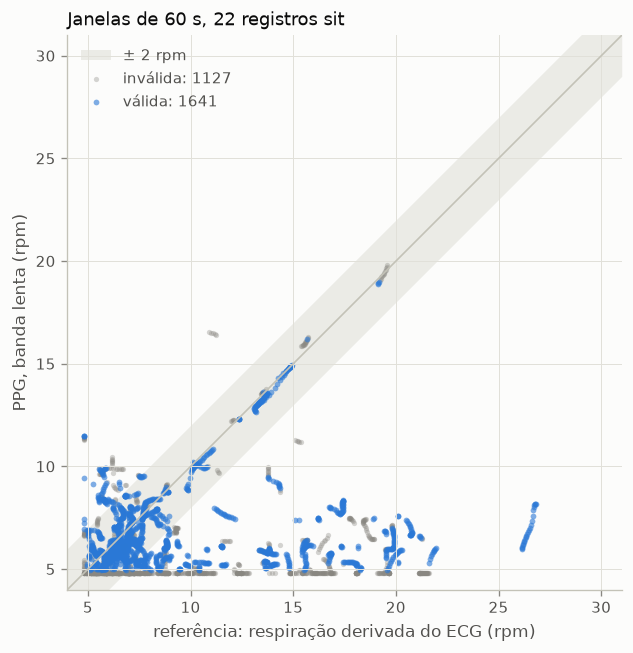

| | |
|---|---|
| Frente | A · João |
| Item do plano | 6 (Alvo) |
| Entrada | bruto (100 Hz, com DC; só o IR) |
| Saída | `ppg_respiracao_t`, uma por segundo |
| Código | `Core/*/pds/respiracao/` |
| Protótipo | `analise/src/analise/respiracao.py` |

**O quê:** frequência respiratória pela banda lenta (passa-faixa de 0,07 a 0,6 Hz, busca de 4,8 a 31,2 rpm).

## Estado

| Passo | Estado |
|---|---|
| 1. Python, validado no PhysioNet | feito, contra a respiração derivada do ECG |
| 2. C sem HAL | feito: `respiracao.h`, `respiracao.c`, `respiracao_coef.h` (gerado) |
| 3. Teste no PC contra os vetores | feito: `testes/respiracao/`, no CI |
| 4. Placa com a fonte falsa | feito: a bancada passou na STM32 (299/299, 6486 ciclos por amostra) |
| 5. Sensor real e metrônomo (6, 10, 15 rpm) | feito: os três ritmos a menos de 2 rpm; a placa bate com o Python |

## Método

### A banda lenta

A respiração mexe no PPG de três jeitos (Charlton et al., 2016):

- **banda lenta (RIIV):** a linha de base sobe e desce com a pressão no tórax;
- **amplitude (RIAV):** o tamanho de cada pulso muda;
- **frequência (RIFV):** a FC acelera na inspiração (arritmia sinusal).

Este módulo usa a banda lenta, que sai direto do bruto e não depende de
achar os picos: é só um filtro e um espectro. A conta, igual no Python e no C:

1. **Média de 25 amostras:** a linha de base cai de 100 pra 4 Hz. O histórico
   guarda o desvio da primeira amostra, pra precisão do float (como na
   decimação).
2. **Passa-faixa Butterworth de 0,07 a 0,6 Hz** a 4 Hz, com 2 biquads
   (IIR). Aqui a fase não importa, porque só a frequência é medida, e o IIR é o
   mais barato.
3. **Janela de 60 s** (240 pontos) com Hann. Com 60 s cabem 6 ciclos mesmo
   a 6 rpm.
4. **Goertzel** em 89 frequências de 0,08 a 0,52 Hz (4,8 a 31,2 rpm, passo
   0,005 Hz), com o pico refinado pela parábola dos vizinhos. Uma estimativa
   por segundo.
5. **Validade:** `valido` só é verdadeiro se:
   - a **qualidade**, ou seja, a fração da potência a até 0,02 Hz do pico,
     for de pelo menos 0,4;
   - o pico **não cair numa ponta da grade**. Pico na ponta quer dizer que a
     potência continua subindo pra fora da faixa (deriva), e não que existe uma
     respiração ali. A grade vai além de 6 e de 30 rpm justamente pra esses dois
     ritmos ficarem no meio.

### A referência: o ECG

O dataset não tem cinta respiratória. A referência é a **respiração derivada
do ECG** (EDR), por dois caminhos independentes, os dois no mesmo espectro:

- a **arritmia sinusal**: a série de intervalos RR;
- a **amplitude do R**: o eixo elétrico do coração gira com o tórax.

Só contam as janelas em que os dois concordam (até 2 rpm de diferença):
quando eles divergem, nem o ECG sabe a resposta.



### Limite conhecido: as ondas de Mayer

Em repouso, a pressão e o tônus dos vasos oscilam perto de 0,1 Hz (ondas de
Mayer). Isso aparece na linha de base do PPG **na mesma frequência que 6 rpm**.
A banda lenta não tem como separar as duas coisas, e é essa a faixa
horizontal de 5 a 7 rpm do gráfico. Respirando no metrônomo (respiração
profunda e regular), a respiração domina a linha de base e o problema
diminui. É por isso que a validação final (#12) é com metrônomo.

Num teste exploratório nos mesmos registros (grade de 6 a 30 rpm, janelas a
cada 10 s, sem a regra da ponta), as outras modulações foram melhores em
repouso:

| Modulação | Erro médio | Até 2 rpm |
|---|---|---|
| banda lenta (RIIV) | 4,6 rpm | 42% |
| amplitude (RIAV) | 3,2 rpm | 56% |
| frequência (RIFV) | 1,8 rpm | 77% |

A frequência (RIFV) parece a melhor, mas a comparação favorece ela: a RIFV é
a mesma arritmia sinusal que está dentro da referência. Se o metrônomo não
der bom resultado, o próximo passo é somar a RIAV e a RIFV (fusão, Karlen et
al., 2013). As duas precisam dos picos, então dependem do módulo `picos`.

## Validação

### 1. Python no PhysioNet

`uv run python -m analise.respiracao`: 22 registros `sit`, 2768 janelas de
60 s (passo de 1 s) com as duas EDR concordando, com referência de 5 a 27 rpm.

| Qualidade mínima | Válidas | Erro médio | Até 2 rpm |
|---|---|---|---|
| 0,3 | 71% | 3,40 rpm | 60% |
| **0,4 (a usada)** | **59%** | **3,22 rpm** | **63%** |
| 0,5 | 43% | 2,98 rpm | 69% |

- Das janelas válidas que erram por mais de 2 rpm, 57% são o caso das ondas
  de Mayer: o PPG diz menos de 7,5 rpm e o ECG diz 9 ou mais. Sem essas, o
  erro médio cai pra 1,36 rpm, com 80% até 2 rpm.
- Quando a respiração aparece na linha de base, a estimativa é boa (a
  diagonal do gráfico de 10 a 20 rpm). O problema é a respiração espontânea em
  repouso, que mexe pouco na linha de base.
- **Metrônomo sintético** (2 min a 6, 10 e 15 rpm, com pulso, deriva e
  ruído): depois do 1º minuto de cada trecho, 60 de 60 estimativas válidas em
  cada ritmo, com erro de no máximo 0,01 rpm.

### 2. C no PC

`testes/respiracao/teste_respiracao.c`, no CI (`pds-host`):

| Caso | Estimativas | Maior erro contra o Python |
|---|---|---|
| `s1_sit` (5 min do bruto decimado) | 299 | 0,00004 rpm; `valido` igual nas 299 |
| `metronomo` (sintético, 6 min) | 360 | 0,00002 rpm; `valido` igual nas 360 |

O teste também confere que o metrônomo dá 6, 10 e 15 rpm (60 de 60 válidas
em cada) e que DC puro nunca é válido. Trocar um sinal no biquad muda o
`valido` em 119 das 299 estimativas do `s1_sit` e em 300 das 360 do metrônomo.

### 3. Placa com a fonte falsa

A fonte falsa padrão tem só 60 s de bruto, o que dá uma janela. A bancada usa
os 5 min do `s1_sit` do vetor de teste (~120 KB na flash):

```bash
cmake --preset Debug -DBANCADA_RESPIRACAO=ON
cmake --build --preset Debug
```

```text
# bancada respiracao: 299 estimativas (esperado 299), 0 diferentes, erro max 0 milesimos de rpm
# bancada respiracao: ciclos por amostra med ... max ... (orcamento 9600): OK
```

**Orçamento:** 1% da CPU por amostra a 100 Hz em média (9600 ciclos). O
espectro (240 × 89 iterações do Goertzel) roda uma vez por segundo. Pela
contagem de instruções em `-O0`, são ~500 mil instruções nessa amostra; com
os acessos à memória (16 das 27 instruções do laço) e os wait states da
flash, devem ser ~0,7 a 0,9 milhão de ciclos (~8 ms), ou ~8000 ciclos por
amostra em média: a margem contra os 9600 é pequena, e o número de verdade
sai da bancada (passo 4). O máximo fica bem acima do orçamento, mas cabe nos
37 ms que a FIFO do sensor aguenta.

**Resultado na placa** (STM32F411, Debug `-O0`, 22/11/2026):

```text
# bancada respiracao: 299 estimativas (esperado 299), 0 diferentes, erro max 0 milesimos de rpm
# bancada respiracao: ciclos por amostra med 6486 max 799083 (orcamento 9600): OK
```

As 299 estimativas saem iguais às do Python. O custo médio, 6 486 ciclos por
amostra (68% do orçamento), ficou abaixo da estimativa de ~8 000; o máximo,
~0,8 milhão de ciclos (~8 ms), é a amostra do espectro, uma vez por segundo,
e cabe nos 37 ms que a FIFO do sensor aguenta.

### 4. Sensor real e metrônomo

A placa manda uma linha `r,n,rpm,valido` por segundo, e a captura grava
`<nome>_respiracao.csv`. Pra cada ritmo (6, 10 e 15 rpm), respire uns 3 min
seguindo um metrônomo com o dedo parado. Ponha o metrônomo no dobro do ritmo
(12, 20 e 30 batidas por minuto): inspira numa batida, expira na outra.

```bash
uv run python -m analise.captura COM3 --segundos 180 -o dados/metronomo_6.csv   # e aperte o reset
uv run python -m analise.respiracao --metronomo dados/metronomo_6.csv --rpm 6
uv run python -m analise.respiracao --confere dados/metronomo_6.csv
```

Abra a captura e só então resete a placa (botão ou
`STM32_Programmer_CLI -c port=SWD -rst`): o `--confere` usa o trecho depois
do último reset e aí compara tudo. Capturando no meio (sem reset), ele começa
no primeiro bloco alinhado com os da placa e só compara depois de 80 s (a
janela de 60 s e o transitório do filtro). O `--metronomo` descarta o 1º
minuto depois do reset (a janela enchendo) e mostra quantas estimativas
saíram válidas, a mediana e o erro médio contra o ritmo. O `--confere` refaz
a conta no Python sobre o bruto da placa. Na placa simulada
no PC (cadeia inteira em C, "sensor" a 400 Hz respirando a 10 rpm), deu 179
estimativas iguais às do Python (erro de 0,005 rpm) e 119 de 119 válidas a
10,0 rpm.

**Resultado com o sensor:**

(dedo preso no sensor, capturas desde o boot, 22/11/2026)

| Metrônomo | Válidas (depois do 1º minuto) | Mediana | Erro médio | Placa = Python |
|---|---|---|---|---|
| 6 rpm (3 min) | 105 de 119 | 6,1 rpm | 0,29 rpm | sim (34 comparadas, 0,004 rpm) |
| 10 rpm (2 min) | 60 de 60 | 8,5 rpm | 1,47 rpm | sim (120 comparadas, 0,005 rpm) |
| 15 rpm (2 min) | 34 de 60 | 14,3 rpm | 0,64 rpm | não deu pra comparar (linhas perdidas na serial) |

Os três ritmos ficam a menos de 2 rpm. A 10 rpm, o pico do espectro está em
8,8 rpm: o algoritmo segue o sinal, e o mais provável é a respiração ter saído
um pouco mais lenta que o metrônomo (as ondas de Mayer aparecem mais fracas,
em 5,5 rpm). Duas capturas foram descartadas: a 1ª de 10 rpm (mediana de 6,6
rpm, com o pico em 7,3 rpm dominando) e a 1ª de 15 rpm (o pico em 5,9 rpm,
e 57 de 60 estimativas inválidas: o `valido` funcionou). Nas duas, o problema
foi a respiração ou o dedo na captura, e a repetição deu certo. A serial
perdeu linhas em todas as capturas longas (o `--confere` compara o maior
trecho contínuo); a causa provável é mau contato nos fios do conversor.
